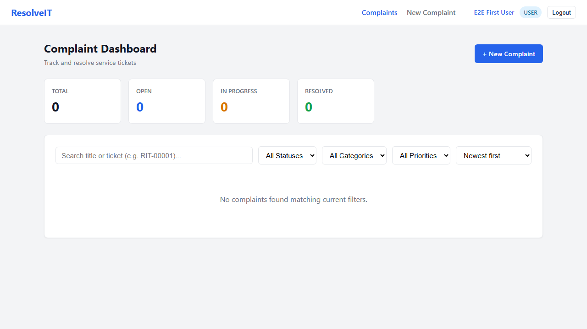
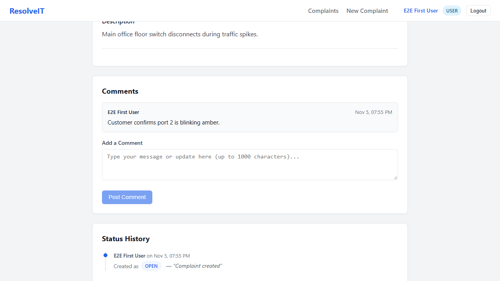
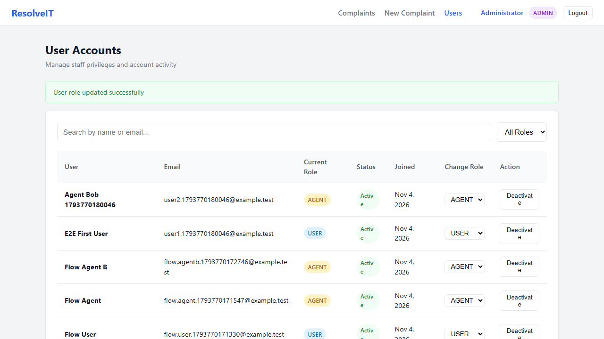
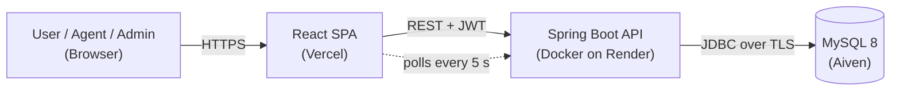
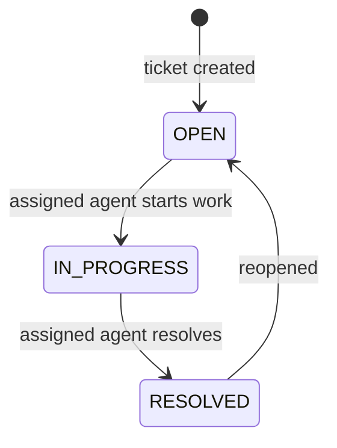
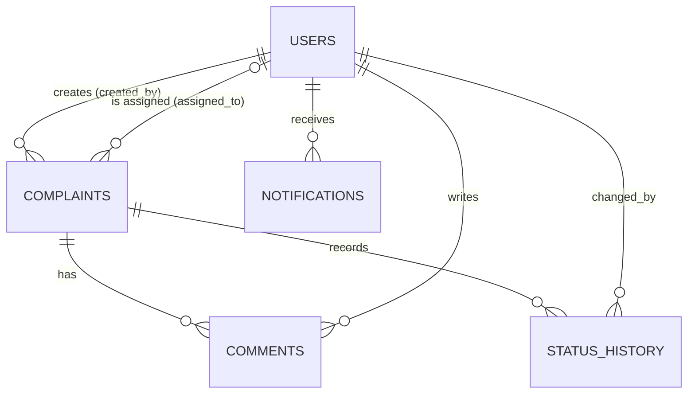

# ResolveIT — Smart Complaint & Ticket Management System

A full-stack help-desk application where users raise complaints, agents resolve them and admins oversee everything. Built with **React**, **Spring Boot** and **MySQL**, containerized with **Docker**, and deployed on **Vercel**, **Render** and **Aiven**.

     

**[Live Demo](https://resolveit-smart-ticket-system.vercel.app)** · **[API Health](https://resolveit-backend-z0js.onrender.com/api/health)** · **[Source Code](https://github.com/Ramprasad-Prajapat/resolveit-smart-ticket-system)**

## Contents

[Overview](#overview) · [Live Demo](#live-demo) · [Quick Tour](#quick-tour-2-minutes) · [Features](#features) · [Architecture](#architecture) · [Tech Stack](#tech-stack) · [Roles & Permissions](#roles--permissions) · [Engineering Highlights](#engineering-highlights) · [API Overview](#api-overview) · [Database Design](#database-design) · [Run Locally](#run-it-locally) · [Environment Variables](#environment-variables) · [Testing](#testing) · [Deployment](#deployment) · [Project Structure](#project-structure) · [Limitations & Roadmap](#limitations--roadmap) · [Author](#author)

## Overview

Support requests in many teams are scattered across e-mails and chats, so nobody knows who owns what or how far a request has progressed. ResolveIT models a realistic service desk to solve that:

- A **user** creates a complaint and follows it from open to resolved.
- An **agent** works only on the tickets assigned to them and updates their status.
- An **admin** assigns and reassigns tickets, manages accounts and sees the full picture.
- Every change is written to an **audit trail**, and the people involved get **live alerts** without refreshing the page.

The project is built to show end-to-end engineering: REST API design, stateless authentication, role-based authorization, a validated ticket state machine, automated testing at several levels, containerization and cloud deployment.

## Live Demo

| What | Link |
|---|---|
| Web application | https://resolveit-smart-ticket-system.vercel.app |
| Backend health check | https://resolveit-backend-z0js.onrender.com/api/health |
| Source code | https://github.com/Ramprasad-Prajapat/resolveit-smart-ticket-system |

> **Note on the first load:** the backend runs on Render's free plan, which sleeps after 15 minutes without traffic. If the demo has been idle, the first request can take **45 to 90 seconds** while the container starts. After that it responds normally.

### Demo logins

All demo accounts use the password **`Demo@1234`**.

| Role | Email | What you can try |
|---|---|---|
| Admin | `admin@resolveit.com` | See all tickets, assign and reassign agents, manage users |
| Agent | `agent1@resolveit.com` | Work on assigned tickets: set IN_PROGRESS or RESOLVED, comment |
| Agent | `agent2@resolveit.com` | Same as above, useful for testing reassignment |
| User | `user1@resolveit.com` | Create tickets, follow them, comment, reopen resolved tickets |
| User | `user2@resolveit.com` | A second user, to see that users only see their own tickets |

This is a shared public demo with sample data. Please do not enter personal information.

## Quick Tour (2 minutes)

Open three browser windows (one can be a private window) so you can watch the roles interact.

1. **User:** sign in as `user1@resolveit.com` and create a complaint (choose a category and a priority).
2. **Admin:** sign in as `admin@resolveit.com`, open that ticket and assign it to `agent1@resolveit.com`.
3. **Agent:** in the third window sign in as `agent1@resolveit.com`. Within about 5 seconds an alert pops up without a page refresh. Open the ticket, set it to IN_PROGRESS and add a comment.
4. **Admin:** reassign the ticket to `agent2@resolveit.com`. `agent1` is notified and can no longer update the ticket.
5. **Agent 2:** resolve the ticket with a note. **User 1** sees the new status and can reopen the ticket if needed.
6. Open the ticket's **history** to see every step (creation, assignment, status changes, reassignment) with who did it and when.





## Features

| Area | What it does |
|---|---|
| Authentication | Registration and login with BCrypt-hashed passwords and stateless JWT sessions; change password and update profile |
| Role-based access | Three roles (USER, AGENT, ADMIN) enforced on the server and mirrored by route guards in the UI |
| Ticket lifecycle | `OPEN → IN_PROGRESS → RESOLVED`, with invalid transitions rejected by the backend; a resolved ticket can be reopened by its creator |
| Admin assignment | Assign or reassign a ticket to any agent at any time; the previous agent immediately loses the right to change it |
| Live alerts | The UI polls every 5 seconds and shows colour-coded toast notifications for assignments and status changes; notifications are stored in the database |
| Audit history | Every ticket keeps a chronological timeline of status changes, assignments and reassignments |
| Discussion | Comment threads on each ticket between the user, the agent and the admin |
| Search and filters | Search and filter by category, priority, status and assignment, with pagination and a dashboard summary |
| Login protection | In-memory rate limiter: after 5 failed logins an account is locked for 15 minutes (HTTP 429) |
| Responsive UI | Works from 320 px phones to desktop screens; tables turn into cards on small screens |

## Architecture



**Backend layers:** `controller` (REST endpoints) → `service` (business rules and the ticket state machine) → `repository` (Spring Data JPA) → MySQL. `security` holds the JWT filter and token provider, `dto` the request and response objects, `exception` the global error handling.

**Ticket lifecycle**



## Tech Stack

| Layer | Technologies |
|---|---|
| Frontend | React 18, Vite 5, React Router 6, native Fetch API, vanilla CSS |
| Backend | Java 21, Spring Boot 3.3.5, Spring Security 6, Spring Data JPA / Hibernate, JJWT 0.12.6, Maven |
| Database | MySQL 8 (InnoDB, utf8mb4), HikariCP connection pool |
| DevOps | Docker (multi-stage build, Eclipse Temurin 21), Vercel, Render, Aiven |
| Testing | JUnit 5, Mockito, JaCoCo, Vitest, Testing Library, Newman (Postman), Playwright |

## Roles & Permissions

| Capability | USER | AGENT | ADMIN |
|---|:---:|:---:|:---:|
| Register and log in | ✔ | ✔ | ✔ |
| Create a ticket | ✔ | ✔ | ✔ |
| See tickets | Own tickets | All tickets | All tickets |
| Edit a ticket | Own, while OPEN | — | Any |
| Delete a ticket | Own, while OPEN | — | Any |
| Assign to themselves | — | If unassigned | ✔ |
| Reassign to another agent | — | — | ✔ |
| Change status | Reopen if resolved | Assigned tickets | ✔ |
| Comment and view history | Own tickets | Any ticket | Any ticket |
| Manage users (role, active) | — | — | ✔ |

## Engineering Highlights

- **Layered design.** Controllers stay thin, business rules live in services, data access in repositories. DTOs separate the API from the database model, and a global exception handler returns consistent error responses.
- **Rules enforced on the server.** The ticket state machine, ownership checks and assignment rules are validated in the backend. The UI route guards only improve usability; they are not the security boundary. For example, an agent who has been reassigned gets HTTP 403 when trying to update the ticket.
- **Stateless security.** JWT (HMAC-SHA256) with a filter that builds the Spring Security context, BCrypt password hashing, role checks on URLs and methods, and a CORS allow-list configured per environment.
- **Auditability.** Each ticket has an immutable timeline of who changed what and when.
- **Brute-force protection.** A sliding-window rate limiter locks an account after repeated failed logins.
- **Production-minded deployment.** Multi-stage Docker image, configuration through environment variables, TLS to the database, a small connection pool and JVM memory flags (`-XX:MaxRAMPercentage=70 -XX:+UseSerialGC`) tuned for a free 512 MB-class instance.
- **Testing at several levels.** Unit and integration tests, component tests, API flow tests, browser end-to-end tests and responsive checks, plus a static scan that fails the build if credentials are committed.

## API Overview

Base path: `/api`. Protected endpoints expect `Authorization: Bearer <token>`. A ready-made Postman collection is in [`postman/`](postman).

| Area | Endpoint | Description |
|---|---|---|
| Health | `GET /health` | Public health check |
| Auth | `POST /auth/register` · `POST /auth/login` | Create an account · get a JWT |
| Auth | `GET /auth/me` · `PUT /auth/me` · `PUT /auth/password` | Current profile · update name · change password |
| Complaints | `GET /complaints` · `POST /complaints` | List with search, filters and pagination · create |
| Complaints | `GET /complaints/summary` | Counts for the dashboard |
| Complaints | `GET /complaints/{id}` · `PUT /complaints/{id}` · `DELETE /complaints/{id}` | Details · edit · delete |
| Workflow | `PATCH /complaints/{id}/status` · `PATCH /complaints/{id}/assign` | Change status · assign or reassign |
| Discussion | `GET /complaints/{id}/comments` · `POST /complaints/{id}/comments` · `GET /complaints/{id}/history` | Comments · audit timeline |
| Admin | `GET /admin/users` · `GET /admin/users/assignable` | All users · agents that can be assigned |
| Admin | `PATCH /admin/users/{id}/role` · `PATCH /admin/users/{id}/active` | Change role · enable or disable an account |
| Notifications | `GET /notifications/unread` · `PATCH /notifications/{id}/read` | Unread alerts · mark as read |

## Database Design

Five tables in MySQL 8: `users`, `complaints`, `comments`, `notifications` and `status_history`.



More detail is in [`database/`](database).

## Run It Locally

**Prerequisites:** Java 21, Maven 3.9+, Node.js 18+ and MySQL 8.

1. Clone the repository:

   ```bash
   git clone https://github.com/Ramprasad-Prajapat/resolveit-smart-ticket-system.git
   cd resolveit-smart-ticket-system
   ```

2. Create the database:

   ```sql
   CREATE DATABASE resolveit_simple_db CHARACTER SET utf8mb4 COLLATE utf8mb4_unicode_ci;
   ```

3. Configure and start the backend:

   ```bash
   cd backend
   cp src/main/resources/application-local.properties.example src/main/resources/application-local.properties
   ```

   (On Windows PowerShell use `copy` instead of `cp`.) In `application-local.properties` set your MySQL password and enable the demo data:

   ```properties
   spring.datasource.password=YOUR_LOCAL_PASSWORD
   app.seed.enabled=true
   app.seed.demo-password=Demo@1234
   ```

   ```bash
   mvn spring-boot:run -Dspring-boot.run.profiles=local
   ```

   The API starts on http://localhost:8080. Check it with `curl http://localhost:8080/api/health`, which returns `{"status":"UP"}`.

4. Start the frontend in a second terminal:

   ```bash
   cd frontend
   npm install
   npm run dev
   ```

5. Open http://localhost:5173 and sign in with any demo account (password `Demo@1234`).

## Environment Variables

**Backend (Render / production)**

| Variable | Description | Example |
|---|---|---|
| `DB_URL` | JDBC connection string | `jdbc:mysql://<host>:<port>/<database>?sslMode=REQUIRED&serverTimezone=UTC` |
| `DB_USERNAME` | Database user | `<database-user>` |
| `DB_PASSWORD` | Database password | `<database-password>` |
| `JWT_SECRET` | Secret used to sign tokens (48+ characters) | `<long-random-secret>` |
| `CORS_ORIGINS` | Allowed frontend origins, comma separated | `https://resolveit-smart-ticket-system.vercel.app` |
| `SPRING_DATASOURCE_HIKARI_MAXIMUM_POOL_SIZE` | Maximum JDBC connections (optional) | `5` |
| `JAVA_TOOL_OPTIONS` | JVM memory options (optional) | `-XX:MaxRAMPercentage=70 -XX:+UseSerialGC` |
| `SEED_ENABLED` / `SEED_DEMO_PASSWORD` | Seed demo data on an empty database (optional) | `false` / `<demo-password>` |

**Frontend (Vercel / production)**

| Variable | Description | Example |
|---|---|---|
| `VITE_API_BASE_URL` | Base URL of the backend API (must end with `/api`) | `https://resolveit-backend-z0js.onrender.com/api` |
| `VITE_POLL_SECONDS` | Notification polling interval in seconds (optional) | `5` |
| `VITE_ALERT_SECONDS` | How long an alert stays visible in seconds (optional) | `30` |

Real secrets are never committed; they are provided only through the hosting dashboards.

## Testing

| Suite | Tooling | Checks |
|---|---|---:|
| Backend unit and integration tests | JUnit 5, Mockito, JaCoCo | 80 |
| Frontend component tests | Vitest, Testing Library | 67 |
| REST endpoint coverage | Spring controllers | 23 |
| API flow | Newman (Postman collection, 40 requests) | 34 |
| Browser end-to-end and responsive audit | Playwright (desktop scenarios and viewport checks from 320 px to 1440 px) | 93 |
| **Local total** | | **297** |

Backend line coverage reported by JaCoCo: services 87 %, security 93 %, controllers 96 %. A static scan additionally fails if credentials are found in the source. The deployed application was also verified with live API and browser checks (authentication, role permissions, CORS, the full ticket lifecycle, routing and responsive layout).

```bash
# Run everything (needs a local MySQL server; it uses its own test database)
node scripts/run-all-tests.mjs

# Or run the parts separately
cd backend && mvn test
cd frontend && npm test
```

## Deployment

| Part | Platform | Notes |
|---|---|---|
| Frontend | Vercel | Built from the `frontend` folder, deployed automatically on every push to `main`; `vercel.json` rewrites all routes to the SPA |
| Backend | Render | Docker web service built from `backend/Dockerfile`; deployed from the Render dashboard (carried over, not verifiable without Render access) |
| Database | Aiven | Managed MySQL 8 reached over TLS (`sslMode=REQUIRED`) |

Step-by-step instructions, including rollback, are in [`docs/DEPLOYMENT.md`](docs/DEPLOYMENT.md).

## Project Structure

```text
resolveit-smart-ticket-system/
├── backend/                    # Spring Boot API
│   ├── src/main/java/com/resolveit/
│   │   ├── config/             # Security, CORS and demo-data configuration
│   │   ├── controller/         # REST endpoints
│   │   ├── dto/                # Request and response objects
│   │   ├── exception/          # Global error handling
│   │   ├── model/              # JPA entities
│   │   ├── repository/         # Spring Data JPA repositories
│   │   ├── security/           # JWT filter and token provider
│   │   └── service/            # Business logic and ticket state machine
│   ├── src/main/resources/     # Application properties and local template
│   ├── Dockerfile              # Multi-stage production image
│   └── pom.xml
├── frontend/                   # React + Vite application
│   ├── src/                    # components, pages, styles, API client, auth and notification contexts
│   ├── e2e/                    # Playwright tests
│   └── vercel.json             # SPA routing for Vercel
├── database/                   # Database documentation (ER diagram, data dictionary)
├── docs/                       # Deployment guide and design notes
├── postman/                    # Postman collection and environment
├── scripts/                    # Test runner (run-all-tests.mjs)
├── render.yaml                 # Render service definition
└── README.md
```

## Limitations & Roadmap

Known limitations, chosen deliberately to keep the project simple and free to host:

- **Cold starts:** the free Render plan sleeps when idle, so the first request can take up to about 90 seconds.
- **Polling instead of push:** alerts arrive within about 5 seconds because the UI polls; WebSockets or Server-Sent Events would make them instant.
- **Rate limiter is in memory:** its counters reset when the backend restarts.
- **Token storage:** the JWT is kept in the browser's `localStorage`; httpOnly cookies would reduce exposure to XSS.
- **No password reset or e-mail:** users can change their password after login, but there is no "forgot password" flow yet.

Ideas for next steps: forgot-password and e-mail notifications, file attachments on tickets, real-time updates, two-factor authentication for admins, and automatic escalation of tickets that stay unassigned.

## Author

**Ramprasad Prajapat** — [GitHub](https://github.com/Ramprasad-Prajapat)
