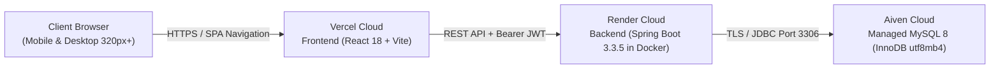
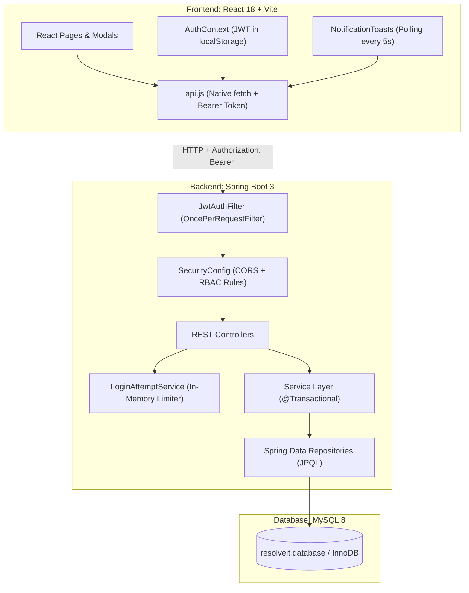

# ResolveIT — Smart Complaint & Ticket Management System

> A clean, production-ready full-stack complaint and service-desk ticket management system built with **Spring Boot 3 (Java 21)**, **React 18 (Vite)**, and **MySQL 8**.

[](#-automated-testing--quality-assurance)
[](#-automated-testing--quality-assurance)
[](#-responsive-design--mobile-experience)

---

## 🌐 Live Deployments

- **Frontend (Vercel):** [https://resolveit-smart-ticket-system.vercel.app](https://resolveit-smart-ticket-system.vercel.app) *(or custom deployment domain)*
- **Backend Health Check:** [https://resolveit-backend.onrender.com/api/health](https://resolveit-backend.onrender.com/api/health)
- **Deployment Documentation:** [`docs/DEPLOYMENT.md`](docs/DEPLOYMENT.md)

> **⏱️ Free-Tier Cloud Notice:** The backend runs on Render's free tier, which spins down after 15 minutes of inactivity. When visiting the live demo, the initial cold-start request may take 45–90 seconds while the container wakes up. Once active, requests respond in under 100ms.

---

## 🏗️ Cloud & System Architecture



### Application Layer Overview



---

## ✨ Key Features

- **Public Landing Page:** Single scrolling landing page featuring hero call-to-actions, live system metrics, feature highlights, role workflows, accessible hamburger menu, and a responsive footer with optional social links configured via `siteInfo.js`.
- **Role-Based Access Control (RBAC):** Three user roles (`USER`, `AGENT`, `ADMIN`) with strict server-side and client-side permissions.
- **Admin Ticket Reassignment:** Administrators can reassign a complaint to another agent at any time. The previous agent is automatically unassigned and forbidden from further status updates with HTTP 403. An immutable audit record (`Reassigned from <old> to <new>`) is logged to the timeline.
- **Live Alert Toasts:** Background polling every 5 seconds delivers top-center popup notifications without full-page reloads. Alerts use color-coded borders (green for assignments, amber for reassignments, blue for admin confirmations) and persist in the database for offline users.
- **Complaint Lifecycle State Machine:** Deterministic ticket lifecycle (`OPEN` → `IN_PROGRESS` → `RESOLVED`) with reopening support.
- **Immutable Audit History:** Every status transition and reassignment is recorded in chronological audit logs.
- **Discussion Threads:** Users, assigned agents, and admins communicate directly on tickets with timestamped comments.
- **Server-Side Pagination & Filtering:** Filter by status, priority, category, or assignment with server-side sorting and pagination.
- **Brute-Force Rate Limiting:** Accounts are automatically throttled with HTTP 429 for 15 minutes after 5 consecutive failed login attempts.
- **Zero-Boilerplate Stack:** Uses native browser `fetch` (no Axios), plain JPQL (no Specification builders), and Postman collections (no Swagger).

---

## 🛠️ Technology Stack

| Layer | Technologies |
|---|---|
| **Backend** | Java 21 LTS, Spring Boot 3.3.5, Spring Security 6, Spring Data JPA, JJWT 0.12.6, Maven 3.9 |
| **Frontend** | React 18, Vite 5.4, React Router DOM 6, Vanilla CSS (design tokens & responsive grid) |
| **Database** | MySQL 8.0+ (InnoDB, `utf8mb4`), Hibernate DDL auto-update (`ddl-auto=update`) |
| **Testing** | JUnit 5, Mockito, JaCoCo 0.8.12, Vitest 2.1, Testing Library, Newman 6.2, Playwright 1.48 |
| **DevOps** | Docker (multi-stage build), Render Blueprint (`render.yaml`), Vercel SPA (`vercel.json`) |

---

## 🔐 Permission Matrix

| Action | USER | AGENT | ADMIN |
|---|---|---|---|
| Register Account / Login | Public | Public | Public |
| View Own Profile / Update Password | Own account | Own account | Own account |
| View Complaints List | Own tickets only | All tickets | All tickets |
| Create Complaint | Yes | Yes | Yes |
| Edit Complaint | Own tickets (while `OPEN`) | No | Any ticket |
| Delete Complaint | Own tickets (while `OPEN`) | No | Any ticket |
| Self-Assign Complaint | No | Yes (if unassigned) | Yes |
| Reassign / Unassign Complaint | No | No | Yes (any ticket) |
| Move Status to `IN_PROGRESS` | No | Yes (assigned tickets) | Yes (assigned tickets) |
| Move Status to `RESOLVED` | No | Yes (assigned tickets) | Yes |
| Reopen Complaint (`RESOLVED` → `OPEN`) | Yes (own tickets) | Yes (assigned tickets) | Yes |
| Post Comments / View History | Own tickets | Any ticket | Any ticket |
| Manage User Roles & Deactivation | No | No | Yes |

---

## 🧭 Application Routing

| Path | Logged-Out Visitors | Logged-In Users |
|---|---|---|
| `/` | **Home Page** (Public single scrolling landing page) | **Dashboard** (Complaints list & summary) |
| `/login` | Sign In form (links to Register & Back to Home) | Redirects to `/` (Dashboard) |
| `/register` | Registration form (password checklist & Back to Home) | Redirects to `/` (Dashboard) |
| `/complaints/new` | Redirects to `/login` | Create Complaint form |
| `/complaints/:id` | Redirects to `/login` | Complaint Details, Comments & History |
| `/complaints/:id/edit` | Redirects to `/login` | Edit Complaint form |
| `/profile` | Redirects to `/login` | Profile update & password change |
| `/admin/users` | Redirects to `/login` | User administration & roles (Admin only) |

---

## ⚙️ Environment Variables Reference

### Backend Variables

| Variable | Description | Example / Default |
|---|---|---|
| `PORT` | Listening port (Render automatically provides this) | `8080` |
| `DB_URL` | JDBC database connection URL | `jdbc:mysql://<host>:<port>/<database>?sslMode=REQUIRED` |
| `DB_USERNAME` | Database username | `root` or `avnadmin` |
| `DB_PASSWORD` | Database password | `<secure-password>` |
| `JWT_SECRET` | Secret key for signing JWT tokens ($\ge$ 32 chars) | `<generated-secret>` |
| `CORS_ORIGINS` | Comma-separated allowed frontend origins | `https://your-frontend.vercel.app` |
| `SPRING_PROFILES_ACTIVE` | Active Spring profile | `prod` (production) or `local` (dev) |
| `SPRING_DATASOURCE_HIKARI_MAXIMUM_POOL_SIZE` | Database connection pool limit | `5` |
| `JAVA_TOOL_OPTIONS` | JVM memory & garbage collector flags | `-XX:MaxRAMPercentage=70 -XX:+UseSerialGC` |
| `SEED_ENABLED` | Whether to load demo tickets and accounts | `false` (default) or `true` (first start) |
| `SEED_DEMO_PASSWORD` | Password assigned to demo accounts | `<runtime-seed-password>` |
| `BOOTSTRAP_ADMIN_EMAIL` | Optional first-start admin email | `admin@example.com` |
| `BOOTSTRAP_ADMIN_PASSWORD` | Optional first-start admin password | `<secure-admin-password>` |

### Frontend Variables

| Variable | Description | Default |
|---|---|---|
| `VITE_API_BASE_URL` | Base URL of the backend REST API | `http://localhost:8080/api` |
| `VITE_POLL_SECONDS` | Interval for live notification polling | `5` |
| `VITE_ALERT_SECONDS` | Duration before live toast auto-dismisses | `30` |

---

## 🚀 Local Quick Start (Git Bash / PowerShell)

### Step 1: Create the MySQL Database
```sql
CREATE DATABASE resolveit_simple_db CHARACTER SET utf8mb4 COLLATE utf8mb4_unicode_ci;
```

### Step 2: Configure Local Properties
Copy the example properties file:
```bash
cp backend/src/main/resources/application-local.properties.example backend/src/main/resources/application-local.properties
```
Configure your local database credentials in `backend/src/main/resources/application-local.properties`.

### Step 3: Start the Backend
```bash
cd backend
mvn spring-boot:run -Dspring-boot.run.profiles=local
```
Backend starts on `http://localhost:8080/api`.

### Step 4: Start the Frontend
```bash
cd frontend
npm install
npm run dev
```
Open `http://localhost:5173` in your browser.

---

## 👥 Demo Accounts

When seed data is loaded (`SEED_ENABLED=true` with `SEED_DEMO_PASSWORD`), the following sample accounts are available:

| Role | Email | Capabilities |
|---|---|---|
| **AGENT** | `agent1@resolveit.com` / `agent2@resolveit.com` | Complaint assignment, status transitions, internal notes |
| **USER** | `user1@resolveit.com` / `user2@resolveit.com` | Complaint submission, tracking, comments, reopening |

> **Security Note:** Demo account passwords are set dynamically at runtime via `SEED_DEMO_PASSWORD` (or configured locally in the git-ignored `application-local.properties`). System administrator accounts are configured via bootstrap environment variables and are never published in public repositories.

---

## 📱 Responsive Design & Mobile Experience

ResolveIT is fully responsive across all device sizes from 320px mobile screens up to 4K ultra-wide monitors:
- **768px Breakpoint:** Desktop navigation collapses into an accessible mobile hamburger drawer with keyboard support (`Enter`, `Space`, `Escape`).
- **640px Breakpoint:** Tabular complaint and user lists transform into vertical cards with `data-label` attribute headers.
- **$\ge$ 44px Touch Targets:** Buttons and interactive controls enforce a minimum 44px height (WCAG 2.1 Criterion 2.5.5).
- **$\ge$ 16px Form Inputs:** Prevents unwanted auto-zooming on iOS Safari when focusing form fields.
- Detailed architecture documentation is available in [`docs/RESPONSIVE.md`](docs/RESPONSIVE.md).

---

## 🧪 Automated Testing & Quality Assurance

ResolveIT features a comprehensive, multi-layered automated test pipeline:

| Test Layer | Total Executed | Passed | Failed | Status / Coverage |
|---|---|---|---|---|
| **Backend Tests (`mvn test`)** | 80 Tests | 80 | 0 | **PASS (100%)** |
| **JaCoCo Service Coverage** | $\ge$ 85% required | 87% | 0 | **PASS** |
| **JaCoCo Security Coverage** | $\ge$ 85% required | 93% | 0 | **PASS** |
| **JaCoCo Controller Coverage** | $\ge$ 80% required | 96% | 0 | **PASS** |
| **Frontend Tests (Vitest)** | 67 Tests | 67 | 0 | **PASS (100%)** |
| **Vitest Components Coverage** | $\ge$ 75% required | 86.59% | 0 | **PASS** |
| **Vitest Pages Coverage** | $\ge$ 75% required | 85.37% | 0 | **PASS** |
| **Controller Endpoint Coverage** | 23 Endpoints | 23 | 0 | **PASS (100%)** |
| **Newman Postman Flow** | 34 Assertions (40 Requests) | 34 | 0 | **PASS (100%)** |
| **Playwright E2E & Edge Tests** | 18 Scenarios | 18 | 0 | **PASS (100%)** |
| **Playwright Responsive Audit** | 75 Viewport Checks | 75 | 0 | **PASS (100%)** |
| **Static Security Scan** | 3 Rules | 3 | 0 | **PASS** |
| **Total Automated Verifications** | **297 Tests & Checks** | **297** | **0** | **PASS (100%)** |

### Running the Test Pipeline

```bash
# Run the complete master test pipeline
node scripts/run-all-tests.mjs

# Run individual suites:
node scripts/run-all-tests.mjs --only=backend     # Backend unit & integration tests + JaCoCo
node scripts/run-all-tests.mjs --only=frontend    # Frontend unit & component tests + Vitest
node scripts/run-all-tests.mjs --only=newman      # Postman API automated flow via Newman
node scripts/run-all-tests.mjs --only=e2e         # Playwright desktop user flows & edge cases
node scripts/run-all-tests.mjs --only=responsive  # Playwright responsive viewport audit
node scripts/run-all-tests.mjs --only=scan        # Static credential leak scan
```

---

## 📸 Screenshots

Verification screenshots are stored in `docs/screenshots/`:
- `home.png` & `home-mobile.png`: Public landing page on desktop and mobile.
- `dashboard.png` & `dashboard-mobile.png`: Dashboard on desktop and table-card layout on mobile.
- `details.png` & `details-mobile.png`: Complaint detail view and timeline on desktop and mobile.
- `login.png`, `register.png`, `profile.png`, `admin-users.png`: Core application views.
- `alert-admin.png`, `alert-new-agent.png`, `alert-previous-agent.png`: Multi-context live notification toasts.

---

## 📡 API Documentation & Postman

Instead of heavy Swagger dependencies, ResolveIT provides a ready-to-use Postman collection and environment:
- **Collection:** `postman/ResolveIT.postman_collection.json`
- **Environment:** `postman/ResolveIT-Local.postman_environment.json`
- **Postman Guide:** [`docs/POSTMAN_GUIDE.md`](docs/POSTMAN_GUIDE.md)
