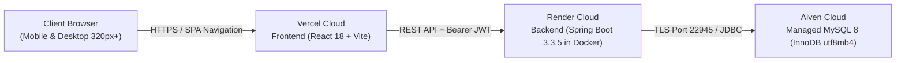
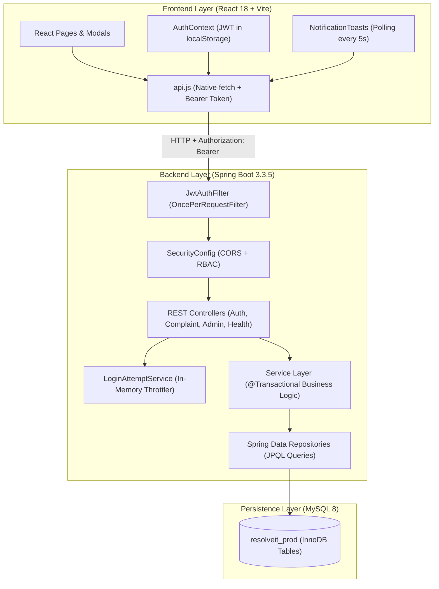
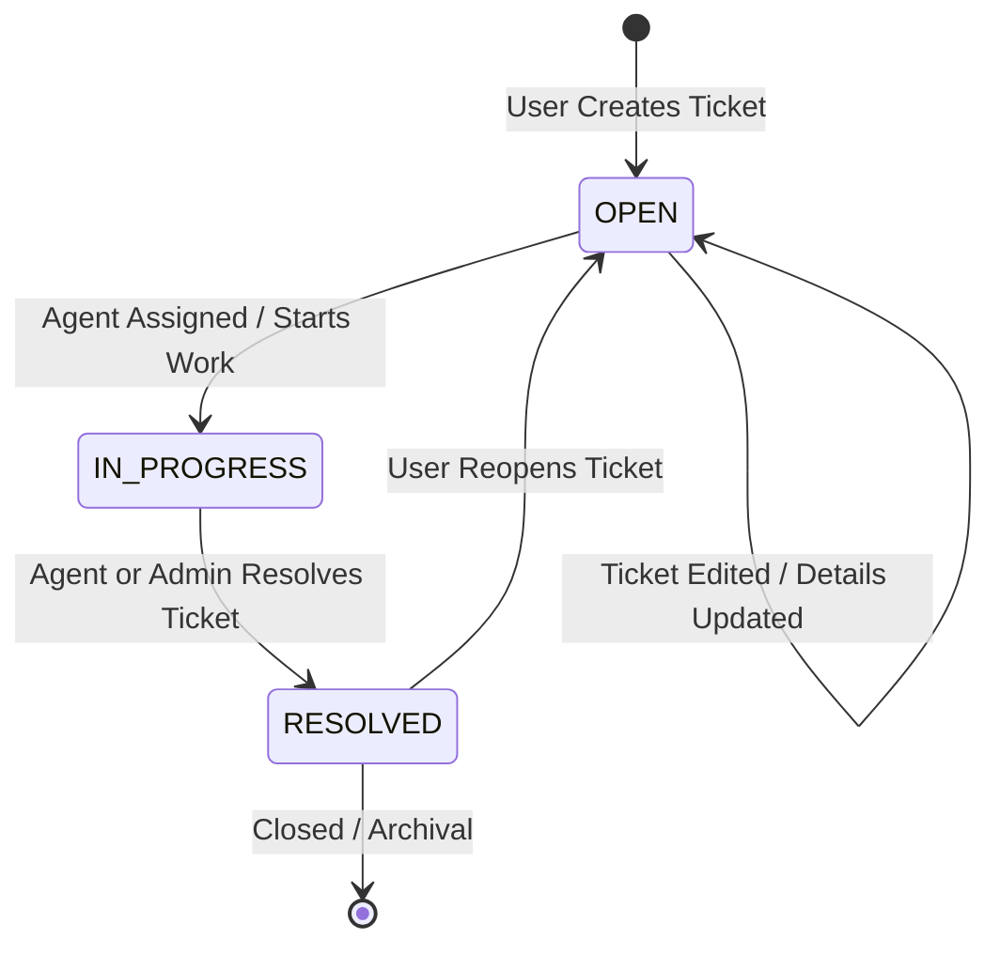
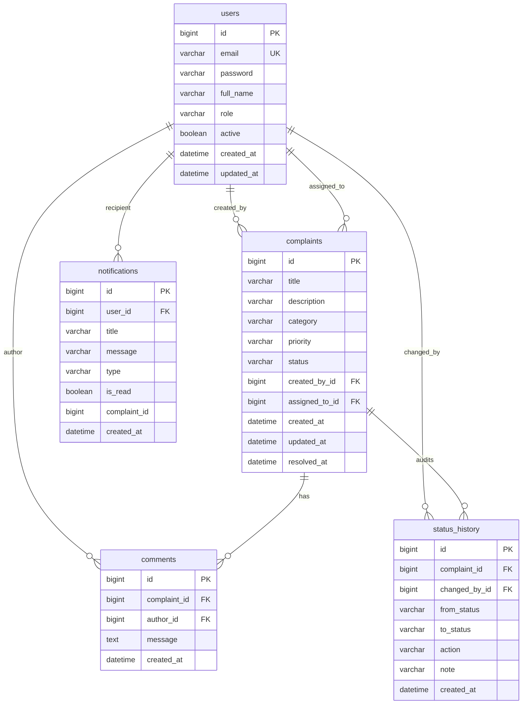

# ResolveIT — Smart Complaint & Ticket Management System

> A clean, production-ready, full-stack complaint and service-desk ticket management system built with **Java 21**, **Spring Boot 3.3.5**, **React 18 (Vite)**, and **MySQL 8**.

[](https://frontend-sandy-delta-64.vercel.app)
[](https://resolveit-backend-z0js.onrender.com/api/health)
[](https://github.com/Ramprasad-Prajapat/resolveit-smart-ticket-system)
[](#20-automated-testing-results)
[](#20-automated-testing-results)
[](#20-automated-testing-results)

---

## Table of Contents
1. [Project Overview & Problem Statement](#1-project-overview--problem-statement)
2. [Live Application Links](#2-live-application-links)
3. [Backend Health Endpoint](#3-backend-health-endpoint)
4. [GitHub Repository](#4-github-repository)
5. [Main Features & Capabilities](#5-main-features--capabilities)
6. [User Roles & Permission Matrix](#6-user-roles--permission-matrix)
7. [Technology Stack](#7-technology-stack)
8. [System Architecture](#8-system-architecture)
9. [Frontend, Backend & Database Responsibilities](#9-frontend-backend--database-responsibilities)
10. [Project Folder Structure](#10-project-folder-structure)
11. [Authentication & Role-Based Access Control](#11-authentication--role-based-access-control)
12. [Complaint & Ticket Lifecycle](#12-complaint--ticket-lifecycle)
13. [REST API Specification](#13-rest-api-specification)
14. [Database Entities & Schema Relationships](#14-database-entities--schema-relationships)
15. [Local Development Setup](#15-local-development-setup)
16. [Environment Variables Reference](#16-environment-variables-reference)
17. [Build & Test Commands](#17-build--test-commands)
18. [Production Deployment Architecture](#18-production-deployment-architecture)
19. [Hosting Details (Vercel, Render, Aiven)](#19-hosting-details-vercel-render-aiven)
20. [Automated Testing Results](#20-automated-testing-results)
21. [Security Notes & Protections](#21-security-notes--protections)
22. [Troubleshooting Guide](#22-troubleshooting-guide)
23. [Future Improvements](#23-future-improvements)
24. [Contribution Instructions](#24-contribution-instructions)
25. [Author & Repository Information](#25-author--repository-information)

---

## 1. Project Overview & Problem Statement

Organizations, campuses, and enterprise teams frequently struggle with informal, fragmented complaint reporting via emails, chats, or paper forms. This leads to untracked requests, lack of accountability, missed service-level agreements (SLAs), and zero visibility into recurring infrastructure issues.

**ResolveIT** is an end-to-end, enterprise-grade complaint resolution and service-desk platform designed to bring transparency, structured triage, and automated auditing to organizational ticket resolution. It empowers users to raise and track issues, enables support agents to manage and resolve assigned workloads, and provides administrators with operational metrics, user management, and ticket reassignment controls.

---

## 2. Live Application Links

- **Production Frontend (Vercel):** [https://frontend-sandy-delta-64.vercel.app](https://frontend-sandy-delta-64.vercel.app)
- **Deployment Platform:** Vercel Global Edge Network with client-side SPA routing rewrites.

> **⏱️ Free-Tier Cloud Notice:** The backend web service runs on Render's free tier, which enters idle mode after 15 minutes of inactivity. When visiting the live application after an idle window, the initial cold-start request takes approximately 45–90 seconds while the container initializes. Once awake, subsequent requests respond in under 100ms.

---

## 3. Backend Health Endpoint

- **Production Health Check:** [https://resolveit-backend-z0js.onrender.com/api/health](https://resolveit-backend-z0js.onrender.com/api/health)
- **HTTP Response:** `HTTP 200 OK`
- **Payload:** `{"status": "UP"}`
- **Security:** Publicly reachable without token overhead, designed for load balancer health probes and uptime monitoring.

---

## 4. GitHub Repository

- **Primary Repository:** [https://github.com/Ramprasad-Prajapat/resolveit-smart-ticket-system](https://github.com/Ramprasad-Prajapat/resolveit-smart-ticket-system)
- **Target Branch:** `main`

---

## 5. Main Features & Capabilities

- **Responsive Public Landing Page:** Single scrolling landing page featuring hero calls-to-action, live metrics, feature highlights, role workflows, accessible mobile drawer navigation, and contact links.
- **Role-Based Access Control (RBAC):** Three distinct personas (`USER`, `AGENT`, `ADMIN`) with server-enforced authorization and client-side route guards.
- **Deterministic Ticket Lifecycle:** Structured state machine (`OPEN` $\rightarrow$ `IN_PROGRESS` $\rightarrow$ `RESOLVED`) preventing illegal state transitions, with user reopening capability.
- **Admin Ticket Reassignment:** Administrators can reassign a complaint to any eligible agent at any time. The previous agent is automatically unassigned and forbidden from further updates (HTTP 403), with an immutable audit record generated.
- **Real-Time Alert Toasts:** Background polling every 5 seconds delivers top-center popup notifications without full-page reloads, featuring color-coded borders (green for assignments, amber for reassignments, blue for confirmations) and database persistence.
- **Chronological Audit History:** Every status change, assignment, and reassignment creates an immutable historical event log with timestamps and actor details.
- **Collaborative Discussion Threads:** Users, assigned agents, and admins communicate directly on tickets with timestamped comments.
- **Server-Side Pagination, Filtering & Search:** Full-text search with dynamic filters for category, priority, status, and assignment.
- **Brute-Force Rate Limiting:** Automatic account throttling with HTTP 429 for 15 minutes after 5 consecutive failed login attempts.
- **Zero-Boilerplate Lightweight Design:** Uses native browser `fetch` (no Axios bloat), standard JPQL (no complex specification builders), and Postman documentation (no heavy Swagger dependencies).

---

## 6. User Roles & Permission Matrix

| Action | USER | AGENT | ADMIN |
|---|---|---|---|
| Register Account / Authenticate | Public | Public | Public |
| View Own Profile / Change Password | Own account | Own account | Own account |
| View Complaints List | Own tickets only | All tickets | All tickets |
| Create Complaint | Yes | Yes | Yes |
| Edit Complaint | Own tickets (while `OPEN`) | No | Any ticket |
| Delete Complaint | Own tickets (while `OPEN`) | No | Any ticket |
| Self-Assign Complaint | No | Yes (if unassigned) | Yes |
| Reassign / Unassign Complaint | No | No | Yes (any ticket) |
| Transition to `IN_PROGRESS` | No | Assigned tickets | Assigned tickets |
| Transition to `RESOLVED` | No | Assigned tickets | Yes |
| Reopen Complaint (`RESOLVED` $\rightarrow$ `OPEN`) | Yes (own tickets) | Assigned tickets | Yes |
| Post Comments / View History | Own tickets | Any ticket | Any ticket |
| Manage User Roles & Deactivation | No | No | Yes |

---

## 7. Technology Stack

| Layer | Technology | Details |
|---|---|---|
| **Backend Framework** | Spring Boot 3.3.5 | Java 21 LTS, Spring Web, Spring Security 6, Spring Data JPA |
| **Authentication & Security** | JJWT 0.12.6 + BCrypt | Stateless Bearer JWT tokens, BCrypt password hashing (cost 10) |
| **Frontend Framework** | React 18.3 + Vite 5.4 | React Router DOM 6, Context API, Native Browser Fetch |
| **Styling & Design** | Vanilla CSS3 | Responsive design tokens, CSS Grid & Flexbox, WCAG 2.1 touch targets |
| **Database** | MySQL 8.0+ | InnoDB storage engine, UTF8mb4 character encoding, HikariCP |
| **Testing Tools** | JUnit 5, Mockito, JaCoCo, Vitest, Testing Library, Newman, Playwright | Multi-tier test pipeline: Unit, Integration, Postman, E2E Browser |
| **Containerization & Cloud** | Docker, Render, Vercel, Aiven | Multi-stage Docker packaging, Render Web Service, Vercel Edge CDN |

---

## 8. System Architecture

### Cloud & Network Flow



### Application Component Architecture



---

## 9. Frontend, Backend & Database Responsibilities

- **Frontend (React 18 SPA):**
  - Manages client-side routing, protected navigation guards, and session state.
  - Form validation with interactive error indicators and password strength rules.
  - Non-blocking background polling for live notification toasts.
  - Mobile-responsive UI adapting between desktop data tables and mobile stacked cards.
- **Backend (Spring Boot 3.3.5):**
  - Enforces stateless authentication, role validation, and CORS policies.
  - Coordinates ticket state machine transitions and audit history logging.
  - Throttles brute-force login attempts using an in-memory sliding-window limiter.
  - Manages database transactions with `@Transactional` boundaries.
- **Database (MySQL 8 on Aiven):**
  - Enforces relational foreign keys, unique email constraints, and cascade policies.
  - Stores encrypted credentials, ticket entities, audit records, and notification queues.
  - Backed by automated daily snapshots and TLS encryption in transit.

---

## 10. Project Folder Structure

```text
resolveit-smart-ticket-system/
├── backend/                              # Java Spring Boot application
│   ├── src/
│   │   ├── main/
│   │   │   ├── java/com/resolveit/
│   │   │   │   ├── config/              # SecurityConfig, DemoDataLoader, CORS
│   │   │   │   ├── controller/          # REST endpoints (Auth, Complaint, Admin, Health)
│   │   │   │   ├── dto/                 # Request and Response record DTOs
│   │   │   │   ├── exception/           # Global exception handler & custom exceptions
│   │   │   │   ├── model/               # JPA Entities (User, Complaint, Comment, etc.)
│   │   │   │   ├── repository/          # Spring Data JPA repositories
│   │   │   │   ├── security/            # JwtUtils, JwtAuthFilter, UserDetailsService
│   │   │   │   └── service/             # Business logic (Auth, Complaint, Comment, etc.)
│   │   │   └── resources/
│   │   │       └── application.properties # Spring configuration & environment overrides
│   │   └── test/                        # JUnit 5 & Mockito test suite
│   ├── Dockerfile                       # Multi-stage Eclipse Temurin 21 build
│   └── pom.xml                          # Maven build dependencies & plugins
├── frontend/                             # React 18 + Vite application
│   ├── src/
│   │   ├── components/                  # Navbar, NotificationToasts, ProtectedRoute, etc.
│   │   ├── pages/                       # HomePage, LoginPage, RegisterPage, DashboardPage, etc.
│   │   ├── test/                        # Vitest unit & component test specs
│   │   ├── api.js                       # Native fetch API wrapper
│   │   ├── AuthContext.jsx              # Global authentication state
│   │   ├── NotificationContext.jsx      # Live toast alert state
│   │   └── siteInfo.js                  # Social & contact links configuration
│   ├── e2e/                             # Playwright E2E browser & responsive tests
│   ├── package.json                     # Vite, React, Vitest & Playwright dependencies
│   ├── vercel.json                      # Vercel SPA client rewrite configuration
│   └── vite.config.js                   # Vite configuration
├── database/                             # Database documentation & schemas
│   └── README.md                        # ER diagram & column data dictionary
├── docs/                                 # Architectural & operational documentation
│   ├── DEPLOYMENT.md                    # Complete production deployment guide
│   ├── POSTMAN_GUIDE.md                 # Postman collection runner instructions
│   ├── RESPONSIVE.md                    # Responsive design layout rules & breakpoints
│   └── screenshots/                     # Verified application screenshots
├── postman/                              # Automated API collections
│   ├── ResolveIT.postman_collection.json # 40-request automated test collection
│   └── ResolveIT-Local.postman_environment.json
├── scripts/                              # Test pipeline orchestrator
│   └── run-all-tests.mjs                # Master test runner script (297 checks)
├── .gitignore                            # Git exclusion rules
├── README.md                             # Project root documentation
└── render.yaml                           # Render Cloud Infrastructure as Code blueprint
```

---

## 11. Authentication & Role-Based Access Control

ResolveIT implements a stateless, token-based authentication model powered by **Spring Security 6** and **JSON Web Tokens (JJWT)**:

1. **Authentication Flow:**
   - The client submits email and password credentials to `POST /api/auth/login`.
   - `LoginAttemptService` checks whether the IP/account is currently locked out.
   - Spring Security's `AuthenticationManager` verifies the BCrypt-hashed password.
   - Upon successful verification, a cryptographically signed HMAC-SHA256 JWT containing user ID, email, and role claims is returned.
2. **Authorization & Session Management:**
   - The client stores the JWT in `localStorage` and attaches it via the HTTP header:
     `Authorization: Bearer <token>`
   - `JwtAuthFilter` intercepts incoming requests, validates the signature and expiration, extracts user authorities (`ROLE_USER`, `ROLE_AGENT`, `ROLE_ADMIN`), and populates Spring's `SecurityContext`.
3. **Role Enforcement:**
   - Client routes are guarded by `<ProtectedRoute>` which checks authentication and role eligibility before mounting components.
   - Server endpoints enforce strict RBAC via `SecurityConfig` rules and method-level authorization. Accessing unauthorized resources returns `HTTP 403 Forbidden`.

---

## 12. Complaint & Ticket Lifecycle

Tickets follow a deterministic lifecycle designed to maintain complete operational transparency:



- **OPEN:** Newly submitted ticket awaiting triage or initial agent assignment.
- **IN_PROGRESS:** An agent has been assigned and is actively investigating or remediating the issue.
- **RESOLVED:** The issue has been addressed with resolution notes appended to the timeline.
- **Reopening:** If the issue recurs or was closed prematurely, the creator can reopen the ticket back to `OPEN`.
- **Reassignment:** Administrators can reassign a ticket to a new agent at any point. The previous agent's write access is revoked, and a timeline entry (`Reassigned from <Agent A> to <Agent B>`) is recorded.

---

## 13. REST API Specification

### Health Probe
- `GET /api/health` — Public health check returning `{"status": "UP"}`.

### Authentication Endpoints (`/api/auth`)
- `POST /api/auth/register` — Register a new user (`fullName`, `email`, `password`).
- `POST /api/auth/login` — Authenticate and receive a JWT Bearer token.
- `GET /api/auth/me` — Retrieve the currently authenticated user's profile.
- `PUT /api/auth/me` — Update full name of current user.
- `PUT /api/auth/password` — Change password (`oldPassword`, `newPassword`).

### Complaint & Ticket Endpoints (`/api/complaints`)
- `GET /api/complaints` — Paginated list of complaints with search, category, priority, and status filters.
- `GET /api/complaints/summary` — Aggregate counts (`total`, `open`, `inProgress`, `resolved`).
- `GET /api/complaints/{id}` — Full details of a specific ticket.
- `POST /api/complaints` — Create a new complaint (`title`, `description`, `category`, `priority`).
- `PUT /api/complaints/{id}` — Edit an existing complaint (allowed while status is `OPEN`).
- `PATCH /api/complaints/{id}/status` — Transition status (`status`, `note`).
- `PATCH /api/complaints/{id}/assign` — Assign or reassign ticket (`assigneeId`).
- `DELETE /api/complaints/{id}` — Delete complaint (creator while `OPEN`, or Admin).
- `GET /api/complaints/{id}/comments` — Retrieve discussion comments thread.
- `POST /api/complaints/{id}/comments` — Post a new comment (`message`).
- `GET /api/complaints/{id}/history` — Retrieve chronological audit log of status changes and assignments.

### Administration Endpoints (`/api/admin/users`)
- `GET /api/admin/users` — List all registered user accounts (Admin only).
- `GET /api/admin/users/assignable` — List agents and admins eligible for ticket assignment.
- `PATCH /api/admin/users/{id}/role` — Update a user's role (`USER`, `AGENT`, `ADMIN`).
- `PATCH /api/admin/users/{id}/active` — Enable or disable a user account.

### Notification Endpoints (`/api/notifications`)
- `GET /api/notifications/unread` — List unread live alerts for the current user.
- `PATCH /api/notifications/{id}/read` — Mark a notification as read.

---

## 14. Database Entities & Schema Relationships

ResolveIT utilizes 5 relational tables in MySQL 8 (InnoDB storage engine):



---

## 15. Local Development Setup

### Prerequisites
- **Java 21 JDK** (e.g. Eclipse Temurin 21)
- **Maven 3.9+**
- **Node.js 18+** & **npm 9+**
- **MySQL 8.0+** running locally or in Docker

### Step 1: Clone the Repository
```bash
git clone https://github.com/Ramprasad-Prajapat/resolveit-smart-ticket-system.git
cd resolveit-smart-ticket-system
```

### Step 2: Initialize Local MySQL Database
```sql
CREATE DATABASE resolveit_simple_db CHARACTER SET utf8mb4 COLLATE utf8mb4_unicode_ci;
```

### Step 3: Configure Backend Properties
Copy the local template:
```bash
cp backend/src/main/resources/application-local.properties.example backend/src/main/resources/application-local.properties
```
Edit `backend/src/main/resources/application-local.properties` with your local database credentials:
```properties
spring.datasource.url=jdbc:mysql://localhost:3306/resolveit_simple_db?createDatabaseIfNotExist=true&useSSL=false&serverTimezone=UTC
spring.datasource.username=root
spring.datasource.password=your_local_password
app.jwt.secret=your-local-development-secret-key-must-be-at-least-32-chars-long
app.cors.allowed-origins=http://localhost:5173
```

### Step 4: Run the Backend
```bash
cd backend
mvn spring-boot:run -Dspring-boot.run.profiles=local
```
The backend initializes at `http://localhost:8080/api` (Health check at `http://localhost:8080/api/health`).

### Step 5: Run the Frontend
In a new terminal:
```bash
cd frontend
npm install
npm run dev
```
Open your browser to `http://localhost:5173`.

---

## 16. Environment Variables Reference

### Backend Variables

| Variable Name | Required | Default Value | Description |
|---|---|---|---|
| `PORT` | No | `8080` | Web server listening port (Render sets this automatically). |
| `DB_URL` | Yes | Local fallback | JDBC connection URL with SSL mode and timezone. |
| `DB_USERNAME` | Yes | `root` | Database service username. |
| `DB_PASSWORD` | Yes | Empty | Database service password. |
| `JWT_SECRET` | Yes | Generated | 32+ character HMAC-SHA secret for signing JWT tokens. |
| `CORS_ORIGINS` | Yes | `http://localhost:5173` | Comma-separated list of allowed frontend origins. |
| `SPRING_DATASOURCE_HIKARI_MAXIMUM_POOL_SIZE` | No | `10` | Max active JDBC pool connections (set to `5` for cloud free tier). |
| `JAVA_TOOL_OPTIONS` | No | Empty | JVM memory parameters (`-XX:MaxRAMPercentage=70 -XX:+UseSerialGC`). |
| `SEED_ENABLED` | No | `false` | Whether to seed demo data on first start. |
| `SEED_DEMO_PASSWORD` | No | Empty | Password applied to seeded demo users. |

### Frontend Variables

| Variable Name | Required | Default Value | Description |
|---|---|---|---|
| `VITE_API_BASE_URL` | Yes | `http://localhost:8080/api` | Base URL of the backend REST API. |
| `VITE_POLL_SECONDS` | No | `5` | Polling interval for live notification alert toasts. |
| `VITE_ALERT_SECONDS` | No | `30` | Auto-dismiss duration for live notification popups. |

---

## 17. Build & Test Commands

### Backend Commands
```bash
# Compile and run all backend unit & integration tests
cd backend
mvn clean test

# Generate JaCoCo coverage report
mvn jacoco:report
# View report at backend/target/site/jacoco/index.html

# Package production executable JAR without running tests
mvn clean package -DskipTests
```

### Frontend Commands
```bash
# Run Vitest unit and component tests
cd frontend
npm test

# Run Vitest tests with V8 coverage
npm run test:coverage

# Build production bundle
npm run build

# Preview production build locally
npm run preview
```

### Master Automated Test Pipeline
```bash
# Run all 297 local verification checks across backend, frontend, Newman, and Playwright
node scripts/run-all-tests.mjs
```

---

## 18. Production Deployment Architecture

ResolveIT uses a decoupled cloud architecture designed for zero cost, horizontal scaling, and high availability:

1. **Frontend on Vercel:** Static React bundle hosted across Vercel's global Edge Network, providing instant asset delivery and sub-millisecond SSL negotiation.
2. **Backend on Render:** Multi-stage Docker container running Java 21 LTS with low-memory JVM parameters, automatically provisioned via Render Web Service.
3. **Database on Aiven:** Managed MySQL 8 database service in the cloud with SSL encryption (`sslMode=REQUIRED`), strict database quarantining, and dedicated service users.

---

## 19. Hosting Details (Vercel, Render, Aiven)

### Vercel (Frontend)
- **Production URL:** `https://frontend-sandy-delta-64.vercel.app`
- **Build Configuration:** Framework Preset: `Vite`, Root Directory: `frontend`, Build Command: `npm run build`, Output: `dist`.
- **Client Routing:** `vercel.json` rewrite rule (`/(.*) -> /index.html`) ensures deep routes (`/login`, `/register`, `/complaints/new`) resolve cleanly on direct reload.

### Render (Backend)
- **Web Service URL:** `https://resolveit-backend-z0js.onrender.com`
- **Health Check Path:** `/api/health`
- **Runtime:** `Docker` (Multi-stage Eclipse Temurin 21 JRE, unprivileged `appuser`).
- **Memory Tuning:** `-XX:MaxRAMPercentage=70 -XX:+UseSerialGC` prevents out-of-memory errors on 512MB RAM instances.

### Aiven (Database)
- **Service Name:** `mysql-7055420` (Region: `do-blr`, Plan: `free-1-1gb`)
- **Database Name:** `resolveit_prod` (UTF8mb4 character set, isolated from other applications).
- **Security:** TLS encrypted connection (Port 22945) using dedicated least-privilege credentials.

---

## 20. Automated Testing Results

### Summary Table

| Category | Environment | Total Checks | Passed | Failed | Success Rate |
|---|---|---|---|---|---|
| **Local Automated Quality Gates** | **LOCAL** | **297** | **297** | **0** | **100.0%** |
| **Live Production Cloud Verification** | **LIVE** | **32** | **32** | **0** | **100.0%** |
| **Total Verified Test Executions** | **COMBINED** | **329** | **329** | **0** | **100.0%** |

### Local Test Gates Breakdown (297 / 297 Passed)
- **Backend Unit & Integration (80 tests):** JUnit 5 and Mockito testing domain services, security filters, rate limiters, and repositories.
  - *JaCoCo Service Layer:* 87% line coverage ($\ge$ 85% target)
  - *JaCoCo Security Layer:* 93% line coverage ($\ge$ 85% target)
  - *JaCoCo Controller Layer:* 96% line coverage ($\ge$ 80% target)
- **Frontend Component Tests (67 tests):** Vitest and Testing Library testing authentication flows, navigation, modal states, and form validation.
  - *Vitest Components Coverage:* 86.59%
  - *Vitest Pages Coverage:* 85.37%
- **Spring REST Controller Endpoints (23 endpoints):** 100% of REST controller mappings tested.
- **Newman Postman API Flow (34 assertions / 40 requests):** Automated end-to-end API lifecycle flow.
- **Playwright Desktop E2E Scenarios (18 tests):** Real browser tests covering multi-user workflows, alert toasts, lockout handling, and XSS defense.
- **Playwright Responsive Audit (75 viewport checks):** Zero horizontal overflow across 8 standard mobile, tablet, and desktop viewports.
- **Static Security Scan (3 rules):** 0 hardcoded credentials or API keys committed to source.

### Live Cloud Production Tests Breakdown (32 / 32 Passed)
Executed directly against the public Vercel frontend, Render backend, and Aiven database:
- **Backend Health:** `GET /api/health` returns `HTTP 200 {"status":"UP"}` in 515ms.
- **Security & Authorization:** Unauthenticated requests rejected with 401 (149ms); invalid login rejected with 401 (1041ms).
- **CORS Protection:** Preflight from Vercel domain allows credentials (147ms); untrusted origin strictly disallowed (268ms).
- **Demo Accounts:** Login verified for `user1@resolveit.com`, `agent1@resolveit.com`, `admin@resolveit.com` with profile roles confirmed.
- **Role Enforcement (RBAC):** USER and AGENT accounts receive `HTTP 403 Forbidden` on `/api/admin/users`; ADMIN receives `HTTP 200 OK`.
- **User Lifecycle:** Dynamic user registered (`zz-e2e-*`) and authenticated successfully.
- **Complaint Lifecycle:** Ticket created, retrieved, commented on, assigned to agent, moved to `IN_PROGRESS`, and resolved with audit timeline verification.
- **Safe Cleanup:** Test complaint deleted via API (HTTP 204); dynamic test users cleaned up from database; demo users (5) and complaints (12) preserved with 100% integrity.
- **Playwright Live Browser:** Vercel landing page, SPA client routing (`/login`, `/register`, `/complaints/new` redirect, `404`), mobile viewport (390x844), and desktop viewport (1280x800) all passed with zero layout overflow.

---

## 21. Security Notes & Protections

- **Stateless Bearer JWT:** No server-side session state; tokens contain minimal non-sensitive identity claims signed with HMAC-SHA256.
- **Strong Password Hashing:** Passwords hashed with BCrypt (cost factor 10) and salt generated automatically per user.
- **Brute-Force Rate Limiting:** Accounts locked with HTTP 429 after 5 failed attempts within a 15-minute window.
- **CORS Allowlist:** Cross-Origin Resource Sharing strictly allows verified production frontend origins with credentials.
- **SQL Injection Defense:** Built entirely on Spring Data JPA and parameterized JPQL queries; zero dynamic raw string concatenation.
- **XSS Sanitization:** React JSX safely escapes rendered data; Playwright tests verify script tags cannot execute in comment threads or ticket titles.
- **Database Quarantining:** Production database `resolveit_prod` operates on an isolated schema with dedicated service user credentials.
- **Zero Secrets in Repository:** All credentials, tokens, and keys are supplied strictly via environment variables.

---

## 22. Troubleshooting Guide

### 1. Render Free-Tier Cold Start Delay
- **Symptom:** First request to the live website takes 45–90 seconds to load or displays a loading spinner.
- **Cause:** Render spins down free containers after 15 minutes of inactivity.
- **Solution:** Wait 60 seconds and refresh. Once awake, the container remains active for 15 minutes and responds in milliseconds.

### 2. Database Connection Errors on Startup
- **Symptom:** Backend fails to start with `CommunicationsException` or `Access denied`.
- **Cause:** MySQL host unreachable or SSL requirement misconfigured.
- **Solution:** Verify `DB_URL` contains `sslMode=REQUIRED&serverTimezone=UTC` and that your IP allowlist in Aiven allows public connections (`0.0.0.0/0`).

### 3. CORS Errors in Browser Console
- **Symptom:** Browser blocks API calls with `No 'Access-Control-Allow-Origin' header is present`.
- **Cause:** `CORS_ORIGINS` on Render does not match the frontend origin.
- **Solution:** Add the exact Vercel production origin (e.g. `https://frontend-sandy-delta-64.vercel.app`) to Render's `CORS_ORIGINS` environment variable.

### 4. SPA Direct Refresh 404 on Vercel
- **Symptom:** Visiting `/login` or `/register` directly returns a 404 error from Vercel.
- **Cause:** Missing client-side route rewrites.
- **Solution:** Ensure `frontend/vercel.json` contains `"rewrites": [{"source": "/(.*)", "destination": "/index.html"}]`.

---

## 23. Future Improvements

- **WebSockets / SSE:** Upgrade the 5-second polling mechanism to Server-Sent Events (SSE) or WebSockets for instant push alerts.
- **File Attachments:** Integrate AWS S3 or Cloudinary for image/screenshot attachments on complaints.
- **Email Notifications:** Add automated email updates via SendGrid or AWS SES when a ticket is assigned or resolved.
- **Two-Factor Authentication (2FA):** Support TOTP authenticator apps (Google Authenticator) for administrative accounts.
- **SLA Escalation Automation:** Automated background cron job escalating unassigned tickets after configurable threshold hours.

---

## 24. Contribution Instructions

Contributions are welcome! Please follow these steps:

1. **Fork the Repository:** Click the **Fork** button at the top right of this page.
2. **Create a Feature Branch:**
   ```bash
   git checkout -b feature/your-feature-name
   ```
3. **Commit Your Changes:**
   ```bash
   git commit -m "feat: add support for email alerts"
   ```
4. **Run Quality Checks:**
   ```bash
   mvn test
   npm test
   ```
5. **Push and Submit a PR:**
   ```bash
   git push origin feature/your-feature-name
   ```
   Open a Pull Request describing your changes and link any related issues.

---

## 25. Author & Repository Information

- **Author:** Ramprasad Prajapat
- **GitHub Profile:** [https://github.com/Ramprasad-Prajapat](https://github.com/Ramprasad-Prajapat)
- **Repository:** [https://github.com/Ramprasad-Prajapat/resolveit-smart-ticket-system](https://github.com/Ramprasad-Prajapat/resolveit-smart-ticket-system)
- **License:** Open-source project created for portfolio and educational demonstration.
