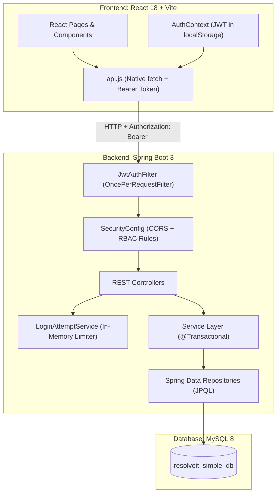

# ResolveIT — Simple Edition

ResolveIT is a clean, full-stack complaint and service-desk ticket management system.
It is built with **Spring Boot 3 (Java 21)**, **React 18 (Vite)**, and **MySQL 8**.

The project uses a simple, readable architecture designed for junior developers and interview review.
Every layer is written without unnecessary frameworks, complex abstractions, or bloated dependencies.

---

## 1. Key Features

- **Public Home Page:** Clean single scrolling landing page with smooth anchor navigation, active section tracking, mobile hamburger menu, a responsive multi-column footer with role shortcuts, and customizable contact links via `siteInfo.js` (add your GitHub, LinkedIn and email here to show a Contact column). Overview sections include Hero, Features, How It Works, Roles, and Footer (navbar: Home, Features, How It Works, Roles, Login).
- **Admin Ticket Reassignment:** Admin can reassign a complaint to another agent (the previous agent is unassigned automatically and forbidden from further status modifications with HTTP 403 "This complaint is not assigned to you"). The current status is preserved, and an audit note is recorded in the status history (`Reassigned from <old> to <new>`). Unassigning an `IN_PROGRESS` ticket resets it back to `OPEN`.
- **Live Popup Alerts (Top-Center):** Live popup alerts checked every 5 seconds without page refresh needed. Color-coded borders distinguish assignment events (green = assigned to you, amber = reassigned/unassigned from you, blue = admin action confirmation). Includes ticket number in bold, quick "View complaint" link, and auto-dismiss after 30 seconds (or on clicking OK/✕). Unread alerts persist in the database so offline agents receive them immediately upon next login.
- **Honest Delay Limit:** The screen updates by **polling every 5 seconds**, so an alert appears within about 5 seconds of the action (not instant push).
- **Role-Based Access Control (RBAC):** Three user roles (`USER`, `AGENT`, `ADMIN`) with strict backend-enforced permissions.
- **Complaint Lifecycle Management:** Tickets follow a deterministic state machine (`OPEN` → `IN_PROGRESS` → `RESOLVED`), with reopen support.
- **Audit History Trail:** Every status change is automatically logged in an immutable audit timeline with actor name, timestamp, and optional transition note.
- **Discussion Threads:** Users, assigned agents, and admins can post comments on any ticket they have access to.
- **Server-Side Pagination & Filtering:** Search by ticket number or text, filter by status, category, priority, or assignment, and sort results server-side.
- **Stateless JWT Authentication:** Secure login, token validation via HTTP Bearer header, and automatic logout on token expiry.
- **Brute-Force Login Protection:** In-memory rate limiter locks accounts for 15 minutes after 5 consecutive failed login attempts (HTTP 429).
- **Profile Management:** Users can update their display name and change their password with client-side password strength validation.
- **Admin User Management:** Administrators can view all registered accounts and promote users to agents or admins.
- **Zero-Boilerplate Stack:** Native browser `fetch` (no Axios), plain JPQL (no Specification builders), and Postman collections (no Swagger).

---

## 2. Technology Stack

### Backend
- **Java 21 LTS**
- **Spring Boot 3.3.5** (`spring-boot-starter-web`, `spring-boot-starter-data-jpa`, `spring-boot-starter-security`, `spring-boot-starter-validation`)
- **Database Driver:** `com.mysql:mysql-connector-j`
- **Security:** Spring Security 6, BCrypt password hashing, JJWT 0.12.6
- **Testing:** JUnit 5, Mockito, Spring Boot Test, H2 in-memory database (for isolated unit/slice tests)

### Frontend
- **React 18** (Vite build tool)
- **Routing:** React Router DOM 6
- **HTTP Client:** Native browser `fetch` API helper
- **Environment Variables:**
  - `VITE_API_BASE_URL`: Base URL of the Spring Boot REST API (defaults to `/api`).
  - `VITE_POLL_SECONDS`: Interval in seconds for unread notification polling (defaults to `5`).
  - `VITE_ALERT_SECONDS`: Duration in seconds before live alert popups auto-dismiss (defaults to `30`).
- **Icons & Styling:** Inline SVGs, clean unified CSS design system with responsive 390px mobile view and `prefers-reduced-motion` support (zero external UI library dependencies)
- **Testing:** Vitest, Testing Library (React, Jest-DOM, User-Event), JSDOM

### Database
- **Engine:** MySQL 8.0+ / InnoDB / utf8mb4
- **Schema Management:** Hibernate automatic schema update (`spring.jpa.hibernate.ddl-auto=update`)
- **Reference DDL:** `database/schema.sql`

---

## 3. High-Level Architecture



---

## 4. Permission Matrix

| Action | USER | AGENT | ADMIN |
|---|---|---|---|
| Register Account / Login | Public | Public | Public |
| View Own Profile | Yes | Yes | Yes |
| Update Name / Change Password | Own account | Own account | Own account |
| View Complaints List | Own tickets only | All tickets | All tickets |
| Create Complaint | Yes | Yes | Yes |
| Edit Complaint | Own tickets (while `OPEN`) | No | Any ticket |
| Delete Complaint | Own tickets (while `OPEN`) | No | Any ticket |
| Self-Assign Complaint | No | Yes (if unassigned) | Yes (can assign/reassign to anyone, or unassign) |
| Reassign / Unassign Complaint | No | No | Yes (even if already assigned) |
| Move Status to `IN_PROGRESS` | No | Yes (assigned tickets) | Yes (assigned tickets) |
| Move Status to `RESOLVED` | No | Yes (assigned tickets) | Yes |
| Reopen Complaint (`RESOLVED` → `OPEN`) | Yes (own tickets) | Yes (assigned tickets) | Yes |
| Post Comments | Own tickets | Any ticket | Any ticket |
| View Audit History | Own tickets | Any ticket | Any ticket |
| Promote User Role | No | No | Yes |

---

## 5. Application Routing

| Path | Logged-Out Visitors | Logged-In Users |
|---|---|---|
| `/` | **Home Page** (Public single scrolling landing page) | **Dashboard** (Complaints list & summary) |
| `/login` | Sign In form (links to Register & Back to Home) | Redirects to `/` (Dashboard) |
| `/register` | Registration form (password checklist & Back to Home) | Redirects to `/` (Dashboard) |
| `/complaints/new` | Redirects to `/login` | Create Complaint form |
| `/complaints/:id` | Redirects to `/login` | Complaint Details, Comments & History |
| `/complaints/:id/edit` | Redirects to `/login` | Edit Complaint form |
| `/profile` | Redirects to `/login` | Profile update & password change |
| `/admin/users` | Redirects to `/login` | User administration & roles (Admin only) |

---

## 6. Prerequisites

Before running the application, make sure you have the following installed:
- **Java Development Kit (JDK):** Version 21 or higher
- **Node.js:** Version 18 or higher (with `npm`)
- **MySQL Server:** Version 8.0 or higher running on `localhost:3306`
- **Apache Maven:** Version 3.9 or higher (or use Maven wrapper)

---

## 6. Quick Start Guide (Git Bash / Command Line)

### Step 1: Create the MySQL Database
Open your MySQL client and create the application database:
```sql
CREATE DATABASE resolveit_simple_db CHARACTER SET utf8mb4 COLLATE utf8mb4_unicode_ci;
```

### Step 2: Configure Local Properties
Copy the example properties file:
```bash
cp backend/src/main/resources/application-local.properties.example backend/src/main/resources/application-local.properties
```
Open `backend/src/main/resources/application-local.properties` and verify your MySQL credentials:
```properties
spring.datasource.url=jdbc:mysql://localhost:3306/resolveit_simple_db?useSSL=false&allowPublicKeyRetrieval=true&serverTimezone=UTC
spring.datasource.username=root
spring.datasource.password=root

# Bootstrap administrator credentials for initial login
app.bootstrap-admin.email=admin@resolveit.local
app.bootstrap-admin.password=<your-secure-password>
app.bootstrap-admin.name=Default Administrator

# Demo data loader: creates sample tickets and users on startup
app.seed.enabled=false
app.seed.demo-password=<your-seed-password>
```

### Step 3: Run the Backend
From the project root directory:
```bash
cd backend
mvn spring-boot:run -Dspring-boot.run.profiles=local
```
The backend starts on `http://localhost:8080/api`.

### Step 4: Run the Frontend
Open a new terminal window:
```bash
cd frontend
npm install
npm run dev
```
Open `http://localhost:5173` in your browser.

---

## 7. Demo Accounts

When seed data is enabled (`app.seed.enabled=true` with `SEED_DEMO_PASSWORD`), sample complaints, audit trails, and role accounts are available:

| Role | Email | Capabilities |
|---|---|---|
| **AGENT** | `agent1@resolveit.com` / `agent2@resolveit.com` | Complaint assignment, status transitions, internal notes |
| **USER** | `user1@resolveit.com` / `user2@resolveit.com` | Complaint submission, tracking, comments, reopening |

> **Security Note:** Demo account passwords are set dynamically at runtime via `SEED_DEMO_PASSWORD` (or defined in the git-ignored `application-local.properties`). The system administrator account is configured via bootstrap environment variables and is never published in public repositories.

---

## 8. Responsive Design & Mobile Experience

ResolveIT is fully responsive across all device sizes from 320px mobile screens up to 4K ultra-wide monitors.
Detailed architecture documentation is available in [`docs/RESPONSIVE.md`](docs/RESPONSIVE.md).

- **Responsive Breakpoints:**
  - `1024px`: Tablet landscape and compact laptop grid adjustments.
  - `768px`: Tablet portrait / large phone breakpoint; desktop navbar collapses into an accessible mobile hamburger drawer.
  - `640px`: Standard mobile phone breakpoint; tabular data collapses into vertical mobile cards with `data-label` attribute headers.
  - `480px`: Small mobile breakpoint (including 320px iPhone SE); pagination collapses into a compact "Page X of Y" counter.
- **Accessibility & Touch Usability:**
  - **$\ge$ 44px Touch Targets:** Buttons, inputs, and interactive controls enforce a minimum 44px height on touchscreens (WCAG 2.1 Criterion 2.5.5).
  - **$\ge$ 16px Mobile Input Font Size:** Prevents unwanted auto-zooming on iOS Safari when focusing form fields.
  - **Zero Horizontal Overflow:** All layouts, modals, and tables adapt cleanly with zero horizontal scrollbars.
  - **Accessible Keyboard Hamburger Drawer:** Operates with mouse/touch or `Enter`, `Space`, and `Escape` keyboard shortcuts.

---

## 9. Automated Testing & Quality Assurance

ResolveIT features a comprehensive, multi-layered automated testing pipeline covering 100% of functional requirements and edge cases.
Detailed traceability is documented in [`docs/TEST-COVERAGE.md`](docs/TEST-COVERAGE.md) and [`docs/TEST-RESULTS.md`](docs/TEST-RESULTS.md).

### Testing Standards & Coverage Thresholds
- **Backend JaCoCo Coverage:** Service layer $\ge$ 85% (Achieved: 87%), Security layer $\ge$ 85% (Achieved: 93%), Controller layer $\ge$ 80% (Achieved: 96%).
- **Frontend Vitest Coverage:** Components $\ge$ 75% (Achieved: 86.6%), Pages $\ge$ 75% (Achieved: 84.4%).
- **Spring Controller vs Postman Endpoint Coverage:** 100% (22/22 endpoints verified).
- **Automated API Flows (Newman):** 57 requests executing complete multi-role workflows.
- **Browser End-to-End & Security Tests (Playwright):** 18 scenarios testing authentication, RBAC, live alerts, XSS defense, and back-button security.
- **Responsive Viewport Audit (Playwright):** 75 automated checks verifying 8 standard viewports across all application states.

### Running the Test Pipeline

The master test runner automatically manages test server lifecycles, database isolation, and test reports:

```bash
# Run the complete test pipeline (Backend, Frontend, Newman, Playwright E2E, Responsive, Security Scan)
node scripts/run-all-tests.mjs

# Run individual suites using --only flags:
node scripts/run-all-tests.mjs --only=backend     # Backend unit & integration tests + JaCoCo report
node scripts/run-all-tests.mjs --only=frontend    # Frontend unit & component tests + Vitest coverage
node scripts/run-all-tests.mjs --only=newman      # Postman API automated flow via Newman
node scripts/run-all-tests.mjs --only=e2e         # Playwright desktop user flows & edge cases (18 scenarios)
node scripts/run-all-tests.mjs --only=responsive  # Playwright responsive viewport audit (75 scenarios)
node scripts/run-all-tests.mjs --only=scan        # Static credential leak scan
```

> **Note on Maven:** If `mvn` is not installed on your system PATH, you can specify its path using `set MVN_CMD=<path-to-mvn.cmd>` (or export `MVN_CMD=<path-to-mvn>` on Linux/macOS).

### Verification Screenshots
Verification screenshots are saved in `docs/screenshots/`:
- `home.png` & `home-mobile.png`: Public marketing page on desktop and mobile.
- `dashboard.png` & `dashboard-mobile.png`: Dashboard on desktop and table-card layout on mobile.
- `details.png` & `details-mobile.png`: Complaint detail view and timeline on desktop and mobile.
- `login.png`, `register.png`, `profile.png`, `admin-users.png`: Core application views.
- `alert-admin.png`, `alert-new-agent.png`, `alert-previous-agent.png`: Multi-context live notification toasts.

---

## 10. API Documentation & Postman

Instead of heavy Swagger dependencies, ResolveIT provides a ready-to-use Postman collection and environment:
- **Collection:** `postman/ResolveIT.postman_collection.json`
- **Environment:** `postman/ResolveIT-Local.postman_environment.json`
- **Guide:** `docs/POSTMAN_GUIDE.md`

Import both files into Postman to explore all endpoints, authenticate, and test endpoints interactively.

---

## 11. Intentional Architecture Choices

1. **Native `fetch` instead of Axios:**
   Native `fetch` is built into modern browsers. Using a 100-line wrapper eliminates 500 KB of node module dependencies while giving direct control over token injection and error handling.
2. **Plain JPQL instead of Specifications:**
   Instead of abstract `CriteriaBuilder` predicates, `ComplaintRepository` uses a readable `@Query` string that any Java developer can understand immediately.
3. **Hibernate `ddl-auto=update` instead of Flyway:**
   Removes database migration overhead and version locking. JPA entities are the single source of truth, and `database/schema.sql` serves as clean documentation.
4. **Postman Collection instead of Swagger:**
   Removes heavy reflection libraries, improves startup performance, and prevents security information leaks in production.
5. **In-Memory Rate Limiting instead of Redis:**
   Protects authentication endpoints from brute-force guessing without requiring an external Redis infrastructure service.
