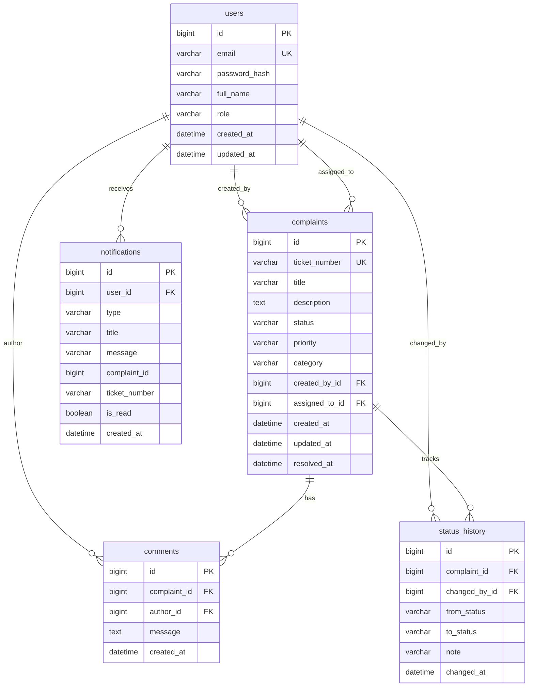

# ResolveIT Simple Edition — Database Documentation

This document describes the database design for ResolveIT Simple Edition.
The application uses MySQL 8.0+ with the InnoDB storage engine and utf8mb4 character encoding.

---

## 1. Entity-Relationship (ER) Diagram

The system uses four clean tables with clear foreign key relationships.



---

## 2. Column Data Dictionary

### Table 1: `users`
Stores registered user accounts, encrypted passwords, and permission roles.

| Column Name | SQL Type | Nullable | Default | Description |
|---|---|---|---|---|
| `id` | `BIGINT` | NO | AUTO_INCREMENT | Unique primary key for the user. |
| `email` | `VARCHAR(150)` | NO | None | Unique login email address. Indexed via unique key. |
| `password_hash` | `VARCHAR(255)` | NO | None | BCrypt hash of user password (cost factor 10). |
| `full_name` | `VARCHAR(100)` | NO | None | User's full display name (e.g., "Alice Smith"). |
| `role` | `VARCHAR(20)` | NO | None | User role: `USER`, `AGENT`, or `ADMIN`. |
| `created_at` | `DATETIME` | NO | None | Timestamp when the user account was registered. |
| `updated_at` | `DATETIME` | NO | None | Timestamp when user details were last modified. |

---

### Table 2: `complaints`
Stores service tickets created by users and managed by agents or admins.

| Column Name | SQL Type | Nullable | Default | Description |
|---|---|---|---|---|
| `id` | `BIGINT` | NO | AUTO_INCREMENT | Unique primary key for the complaint. |
| `ticket_number` | `VARCHAR(30)` | NO | None | Business ticket identifier (e.g., `RIT-00001`). Unique. |
| `title` | `VARCHAR(150)` | NO | None | Short summary of the reported issue (3 to 150 chars). |
| `description` | `TEXT` | NO | None | Detailed description of the problem (10 to 5000 chars). |
| `status` | `VARCHAR(20)` | NO | None | Current lifecycle state: `OPEN`, `IN_PROGRESS`, `RESOLVED`. |
| `priority` | `VARCHAR(20)` | NO | None | Urgency level: `LOW`, `MEDIUM`, `HIGH`, `URGENT`. |
| `category` | `VARCHAR(30)` | NO | None | Department category: `TECHNICAL`, `BILLING`, `ACCOUNT`, `GENERAL`, `OTHER`. |
| `created_by_id` | `BIGINT` | NO | None | Foreign key pointing to `users(id)` (the ticket creator). |
| `assigned_to_id` | `BIGINT` | YES | NULL | Foreign key pointing to `users(id)` (staff assigned). NULL if unassigned. |
| `created_at` | `DATETIME` | NO | None | Timestamp when complaint was submitted. |
| `updated_at` | `DATETIME` | NO | None | Timestamp when complaint was last updated. |
| `resolved_at` | `DATETIME` | YES | NULL | Timestamp when status was set to `RESOLVED`. Reset to NULL on reopen. |

---

### Table 3: `comments`
Stores conversation messages on a complaint.

| Column Name | SQL Type | Nullable | Default | Description |
|---|---|---|---|---|
| `id` | `BIGINT` | NO | AUTO_INCREMENT | Unique primary key for the comment. |
| `complaint_id` | `BIGINT` | NO | None | Foreign key to `complaints(id)`. |
| `author_id` | `BIGINT` | NO | None | Foreign key to `users(id)` who posted the comment. |
| `message` | `TEXT` | NO | None | Message body text (1 to 2000 chars). |
| `created_at` | `DATETIME` | NO | None | Timestamp when comment was posted. |

---

### Table 4: `status_history`
Stores an immutable audit trail of every status transition.

| Column Name | SQL Type | Nullable | Default | Description |
|---|---|---|---|---|
| `id` | `BIGINT` | NO | AUTO_INCREMENT | Unique primary key for the audit record. |
| `complaint_id` | `BIGINT` | NO | None | Foreign key to `complaints(id)`. |
| `changed_by_id` | `BIGINT` | NO | None | Foreign key to `users(id)` who executed the transition. |
| `from_status` | `VARCHAR(20)` | YES | NULL | Status before transition. NULL for the initial creation event. |
| `to_status` | `VARCHAR(20)` | NO | None | Target status after transition. |
| `note` | `VARCHAR(255)` | YES | NULL | Optional explanation provided by the user or agent. |
| `changed_at` | `DATETIME` | NO | None | Timestamp when transition occurred. |

---

### Table 5: `notifications`
Stores real-time alert notifications for assignment and reassign events.

| Column Name | SQL Type | Nullable | Default | Description |
|---|---|---|---|---|
| `id` | `BIGINT` | NO | AUTO_INCREMENT | Unique primary key for the notification. |
| `user_id` | `BIGINT` | NO | None | Foreign key to `users(id)` (recipient). |
| `type` | `VARCHAR(30)` | NO | None | Notification category: `ASSIGNED_TO_YOU`, `REASSIGNED_FROM_YOU`, `UNASSIGNED_FROM_YOU`. |
| `title` | `VARCHAR(100)` | NO | None | Short notification headline. |
| `message` | `VARCHAR(500)` | NO | None | Full context message sentence. |
| `complaint_id` | `BIGINT` | YES | NULL | Plain ID of related complaint (no FK to preserve alert if complaint deleted). |
| `ticket_number` | `VARCHAR(30)` | YES | NULL | Snapshot string of ticket number (e.g. `RIT-00001`). |
| `is_read` | `BOOLEAN` | NO | `FALSE` | Read flag for delivery tracking. |
| `created_at` | `DATETIME` | NO | None | Timestamp when notification was generated. |

---

## 3. Foreign Key Constraints & Cascade Rules

| Constraint Name | Child Table & Column | Parent Table & Column | On Delete | On Update | Rationale |
|---|---|---|---|---|---|
| `fk_complaints_created_by` | `complaints.created_by_id` | `users.id` | `RESTRICT` | `CASCADE` | Preserves ticket audit history. A user who created complaints cannot be deleted without reassigning or purging records. |
| `fk_complaints_assigned_to` | `complaints.assigned_to_id` | `users.id` | `SET NULL` | `CASCADE` | If an assigned agent account is deleted, complaints become unassigned instead of breaking. |
| `fk_comments_complaint` | `comments.complaint_id` | `complaints.id` | `CASCADE` | `CASCADE` | When a complaint is deleted, all associated comments are cleaned up automatically. |
| `fk_comments_author` | `comments.author_id` | `users.id` | `RESTRICT` | `CASCADE` | Prevents deleting authors whose comments are part of the complaint record. |
| `fk_history_complaint` | `status_history.complaint_id` | `complaints.id` | `CASCADE` | `CASCADE` | When a complaint is deleted, all audit history is removed with it. |
| `fk_history_changed_by` | `status_history.changed_by_id` | `users.id` | `RESTRICT` | `CASCADE` | Preserves audit accountability for who changed statuses. |
| `fk_notifications_user` | `notifications.user_id` | `users.id` | `CASCADE` | `CASCADE` | When a user account is deleted, unread alerts are cleaned up automatically. |

---

## 4. Indexing Strategy & Performance Rationale

1. **`uk_users_email` (`users.email`)**:
   - Ensures login emails are unique across the system.
   - Provides $O(1)$ fast lookup during authentication and registration.

2. **`uk_complaints_ticket_number` (`complaints.ticket_number`)**:
   - Ensures ticket numbers (e.g. `RIT-00001`) are unique.
   - Enables fast direct lookup when searching by ticket code.

3. **`idx_complaints_created_by` (`complaints.created_by_id`)**:
   - Standard user role queries only show tickets created by that user (`WHERE created_by_id = ?`).
   - Speeds up user dashboard load times.

4. **`idx_complaints_assigned_to` (`complaints.assigned_to_id`)**:
   - Agents frequently query tickets assigned to them (`WHERE assigned_to_id = ?`).
   - Powers the "Assigned to me" dashboard filter.

5. **`idx_complaints_status` (`complaints.status`)**:
   - Status filtering (`status = 'OPEN'`) and summary metric cards (`COUNT WHERE status = ...`) query this column on every page load.

6. **`idx_complaints_created_at` (`complaints.created_at`)**:
   - Default sorting for the dashboard is `ORDER BY created_at DESC`.
   - Index enables index scans without disk sort overhead.

7. **`idx_comments_complaint_id` (`comments.complaint_id`)**:
   - Loading complaint details fetches all comments (`WHERE complaint_id = ? ORDER BY created_at ASC`).

8. **`idx_history_complaint_id` (`status_history.complaint_id`)**:
   - Loading complaint details fetches the timeline (`WHERE complaint_id = ? ORDER BY changed_at ASC`).

9. **`idx_notifications_user_read` (`notifications.user_id, notifications.is_read`)**:
   - Polling checks unread alerts for a specific user (`WHERE user_id = ? AND is_read = false ORDER BY created_at ASC LIMIT 5`).
   - Composite index guarantees sub-millisecond polling queries.

---

## 5. First Admin Account Setup Guide

There are two recommended ways to create your initial administrator account.

### Approach 1: Application Bootstrap (Recommended)

Configure the bootstrap properties in your `backend/src/main/resources/application-local.properties` file:

```properties
app.bootstrap.admin.enabled=true
app.bootstrap.admin.email=admin@example.com
app.bootstrap.admin.password=YourSecurePassword123
app.bootstrap.admin.full-name=System Administrator
```

When Spring Boot starts up:
1. `AdminBootstrap.java` checks whether `app.bootstrap.admin.email` already exists in the database.
2. If it does not exist, it creates the admin account with role `ADMIN` and hashes the password with BCrypt.
3. If it already exists, it leaves the account untouched without altering passwords.

### Approach 2: Direct SQL INSERT

If you prefer to insert the administrator directly via the MySQL CLI or phpMyAdmin:

1. Generate a BCrypt hash for your desired password using Spring Boot CLI, OpenSSL, or an online BCrypt tool (cost factor 10). Example hash placeholder:
   `<bcrypt-hash>`

2. Execute the INSERT query:

```sql
USE resolveit;

INSERT INTO users (email, password_hash, full_name, role, created_at, updated_at)
VALUES (
  'admin@example.com',
  '<bcrypt-hash>',
  'System Administrator',
  'ADMIN',
  NOW(),
  NOW()
);
```

---

## 6. Why Hibernate `ddl-auto=update` Is Used

ResolveIT Simple Edition intentionally avoids complex migration tools like Flyway or Liquibase for this architecture:

- **Fresher-Friendly Architecture**: Junior developers and interviewers can clone the project, configure `application-local.properties`, and run the backend immediately without migration versioning errors or checksum mismatches.
- **Single Source of Truth**: JPA entity classes in `com.resolveit.model.*` define table columns, constraints, and relationships.
- **`database/schema.sql` As Reference**: `database/schema.sql` reflects the exact structure Hibernate produces, providing full transparency for database administrators and code reviewers.
