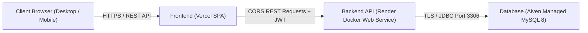

# ResolveIT — Production Deployment Guide (Aiven + Render + Vercel)

This guide documents the full automated and manual steps required to deploy the **ResolveIT Smart Complaint & Ticket Management System** to production using the cloud free-tier architecture.

---

## 1. Architecture Overview



- **Frontend:** React 18 SPA hosted on **Vercel** with global CDN edge routing and client-side route rewrites via `vercel.json`.
- **Backend:** Spring Boot 3.3.5 Docker container on **Render** (Free tier, auto-sleeps after 15 minutes of inactivity).
- **Database:** Managed MySQL 8 on **Aiven** cloud with SSL encryption (`sslMode=REQUIRED`).

---

## 2. Prerequisites & Accounts

1. **GitHub:** `https://github.com/Ramprasad-Prajapat/resolveit-smart-ticket-system`
2. **Aiven Console:** `https://console.aiven.io/` (Project: `ramprasadprajapat709-500c`)
3. **Render Dashboard:** `https://render.com/`
4. **Vercel Dashboard:** `https://vercel.com/ramprasad-prajapats-projects`

---

## 3. Step 1: Push Code to GitHub

From the local project root (`C:\Resume-Project\resolveit-smart-ticket-system`):

```bash
git push -u origin main
```

> **Note on Authentication:** When prompted by Git, sign in via your browser or provide a GitHub Personal Access Token (PAT) with `repo` scope.

---

## 4. Step 2: Aiven MySQL Configuration

1. Log in to the [Aiven Console](https://console.aiven.io/account/a5c9a2562d42/project/ramprasadprajapat709-500c/services).
2. Locate the existing **MySQL** service.
   - If it is powered off, click **Power On** and wait for status to show **Running**.
   - Note the **Host**, **Port** (e.g. `14125`), **User** (`avnadmin`), and **Password**.
3. Connection verification:
   Verify the connection from your local terminal using MySQL client over SSL:
   ```bash
   mysql -h <host> -P <port> -u avnadmin -p --ssl-mode=REQUIRED
   ```
4. Dedicated Database (Optional):
   Create a dedicated database if needed, or use the default `defaultdb`:
   ```sql
   CREATE DATABASE IF NOT EXISTS resolveit CHARACTER SET utf8mb4 COLLATE utf8mb4_unicode_ci;
   ```
5. Construct the Render JDBC URL:
   ```
   jdbc:mysql://<host>:<port>/defaultdb?sslMode=REQUIRED&serverTimezone=UTC
   ```

---

## 5. Step 3: Render Backend Deployment

### Option A: Using Blueprint (`render.yaml`)
1. In the Render Dashboard, click **New +** → **Blueprint**.
2. Connect your GitHub repository `resolveit-smart-ticket-system`.
3. Render automatically detects `render.yaml` and sets up the `resolveit-backend` Docker web service.

### Option B: Manual Web Service
1. Click **New +** → **Web Service**.
2. Connect repository `Ramprasad-Prajapat/resolveit-smart-ticket-system`.
3. Configure settings:
   - **Name:** `resolveit-backend`
   - **Region:** Singapore (or region closest to Aiven service)
   - **Root Directory:** `backend`
   - **Runtime:** `Docker`
   - **DockerfilePath:** `./Dockerfile`
   - **Instance Type:** `Free`
   - **Health Check Path:** `/api/health`

### Environment Variables on Render
Set the following environment variables in the Render service settings:

| Variable | Value / Description | Sensitive |
|---|---|---|
| `DB_URL` | `jdbc:mysql://<host>:<port>/defaultdb?sslMode=REQUIRED&serverTimezone=UTC` | Yes |
| `DB_USERNAME` | `avnadmin` (Aiven username) | Yes |
| `DB_PASSWORD` | `<Aiven Password>` | Yes |
| `JWT_SECRET` | 48+ character secure secret | Yes |
| `CORS_ORIGINS` | Placeholder initially; update to your Vercel URL (e.g. `https://resolveit-smart-ticket-system.vercel.app`) | No |
| `SPRING_DATASOURCE_HIKARI_MAXIMUM_POOL_SIZE` | `5` | No |
| `JAVA_TOOL_OPTIONS` | `-XX:MaxRAMPercentage=70 -XX:+UseSerialGC` | No |
| `SEED_ENABLED` | `true` (on first deploy only) | No |
| `SEED_DEMO_PASSWORD` | `<Your Secure Demo Password>` (on first deploy only) | Yes |

### Initial Seeding vs. Production Mode
1. **Initial Deployment (First Start Only):**
   - Leave `SPRING_PROFILES_ACTIVE` unset.
   - Set `SEED_ENABLED=true` and provide `SEED_DEMO_PASSWORD`.
   - Deploy. Check Render deployment logs to confirm tables are created by Hibernate (`ddl-auto=update`) and 12 demo complaints + 5 users + 2 notifications are seeded.
2. **Switching to Production:**
   - Once seeded, set `SPRING_PROFILES_ACTIVE=prod`.
   - Set `SEED_ENABLED=false` and delete `SEED_DEMO_PASSWORD`.
   - Click **Manual Deploy** → **Deploy latest commit**.
   - Verify `GET https://<service>.onrender.com/api/health` returns `{"status":"UP"}`.

---

## 6. Step 4: Vercel Frontend Deployment

1. Log in to [Vercel Dashboard](https://vercel.com/ramprasad-prajapats-projects).
2. Click **Add New...** → **Project**.
3. Import the `resolveit-smart-ticket-system` repository.
4. Configure project build settings:
   - **Framework Preset:** Vite
   - **Root Directory:** `frontend` (Click Edit and select the `frontend` folder)
   - **Build Command:** `npm run build`
   - **Output Directory:** `dist`
5. **Environment Variables:**
   - `VITE_API_BASE_URL` = `https://<your-render-service>.onrender.com/api`
   *(Important: Do NOT set `VITE_POLL_SECONDS` or `VITE_ALERT_SECONDS` in production so defaults apply).*
6. Click **Deploy**.
7. Note your assigned Vercel production URL (e.g. `https://resolveit-smart-ticket-system.vercel.app`).

---

## 7. Step 5: CORS Loopback Finalization

1. Return to the **Render Dashboard** → `resolveit-backend` → **Environment**.
2. Update `CORS_ORIGINS` to include your live Vercel domain:
   ```
   CORS_ORIGINS=https://resolveit-smart-ticket-system.vercel.app
   ```
   *(If using custom domains or Vercel preview URLs, separate them with commas).*
3. Render will automatically redeploy the backend with the updated CORS allowlist.
4. Verify from your browser:
   - Open your Vercel website.
   - Inspect network traffic on login / health check.
   - Confirm preflight OPTIONS requests return `200 OK` with `Access-Control-Allow-Origin`.

---

## 8. Verifying the Deployment

### Smoke Tests
- [ ] `GET https://<render-service>.onrender.com/api/health` returns `{"status":"UP"}`.
- [ ] Visiting Vercel root URL opens the Home landing page with hero, statistics, features, and footer.
- [ ] Refreshing on direct links (e.g. `/login`, `/register`) loads properly without 404s (verified via `vercel.json`).
- [ ] Login with demo account works and navigates to the role-specific dashboard.
- [ ] Creating a ticket, updating status, and adding comments work cleanly.

### Cold-Start Behavior (Render Free Tier)
Render spins down free web services after 15 minutes of inactivity. When visiting the site after an idle period:
- The initial API request may take 45–90 seconds while the container boots up.
- The UI handles loading states cleanly. Once awake, subsequent requests respond in under 100ms.

---

## 9. Rollback & Troubleshooting

- **Backend rollback:** In Render, navigate to **Deploys**, select any prior successful build, and click **Rollback to this deploy**.
- **Frontend rollback:** In Vercel, navigate to **Deployments**, locate the last healthy deployment, click **...** → **Promote to Production**.
- **Database resets:** The production database schema is managed automatically by Hibernate (`ddl-auto=update`).
