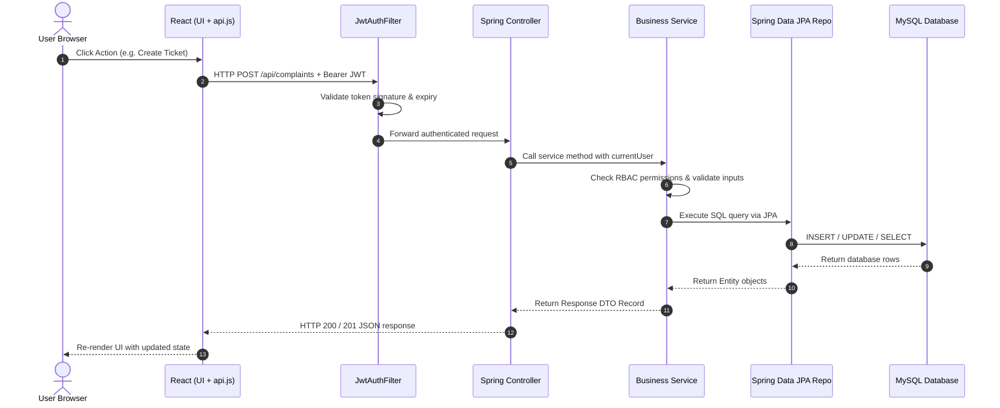
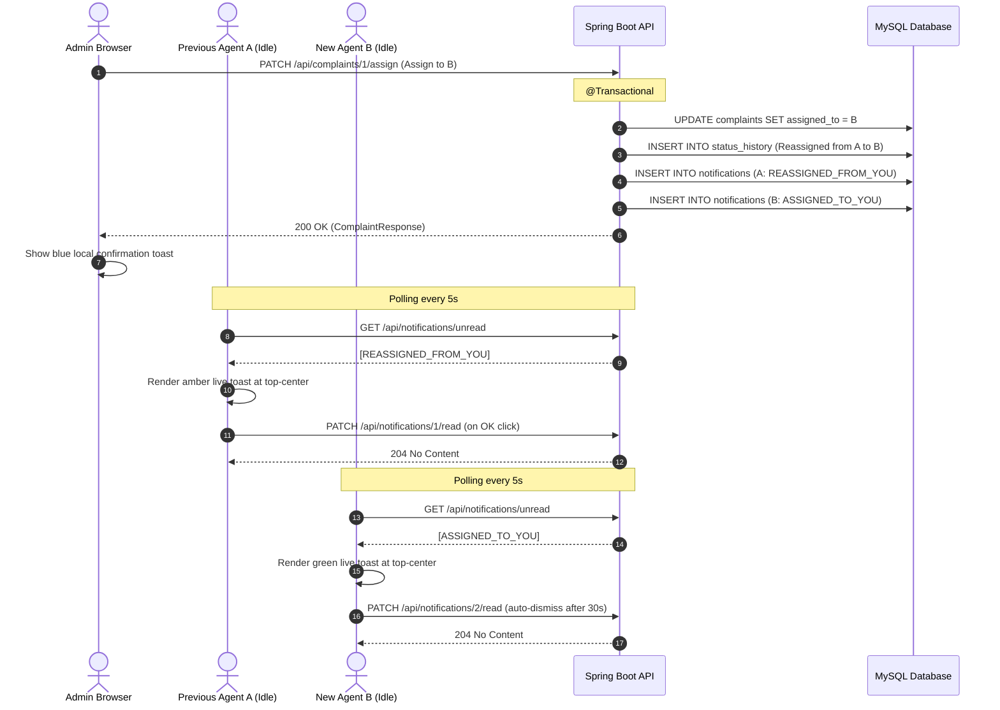

# How ResolveIT Works — Deep Dive Architecture Guide

This document explains the internal mechanics of ResolveIT Simple Edition.
It is written in simple, clear English for students, junior developers, and technical interviewers.

---

## 1. System Architecture Overview

ResolveIT connects three layers: a React 18 single-page frontend, a Spring Boot 3 REST API backend, and a MySQL relational database.



---

## 2. Seven End-to-End User Journeys

### Journey 1: User Registration & Login

1. **User input**: The user types full name, email, and password into `RegisterPage.jsx`.
2. **Client validation**: React checks length, password requirements, and matching confirm password.
3. **HTTP call**: `api.register()` sends `POST /api/auth/register` with JSON body.
4. **Backend controller**: `AuthController.register()` validates input constraints (`@Valid`).
5. **Business service**:
   - `AuthService` checks `userRepository.existsByEmail()`. Throws HTTP 409 if taken.
   - Hashes raw password using `BCryptPasswordEncoder.encode(rawPassword)`.
   - Saves new `User` entity with role `USER`.
   - Generates a signed JWT token via `JwtUtil.generateToken(email, role)`.
6. **Response**: HTTP 201 Created with `{ token, user }`.
7. **Storage**: `AuthContext.jsx` saves token and user info into `localStorage`.
8. **Login throttling**:
   - On failed password in `AuthController.login()`, `LoginAttemptService.recordFailure(email)` is called.
   - If failures reach 5 within 15 minutes, subsequent calls throw HTTP 429 Too Many Requests.

---

### Journey 2: Complaint Creation & Ticket Number Generation

1. **User input**: User fills out title, description, category, and priority on `ComplaintFormPage.jsx`.
2. **HTTP call**: `api.createComplaint()` sends `POST /api/complaints` with `Authorization: Bearer <token>`.
3. **Filter**: `JwtAuthFilter` extracts email from the token, loads the user from `UserRepository`, and sets Spring Security context.
4. **Controller**: `ComplaintController.createComplaint(@Valid @RequestBody ComplaintRequest req, @AuthenticationPrincipal User currentUser)`.
5. **Service**:
   - `ComplaintService.createComplaint()` instantiates `Complaint` entity with status `OPEN` and `createdBy = currentUser`.
   - Leaves `ticketNumber` temporarily empty and saves to generate the database `id`.
   - Generates ticket number string: `"RIT-" + String.format("%05d", complaint.getId())` (e.g. `RIT-00001`).
   - Creates initial `StatusHistory` record with `fromStatus = null`, `toStatus = OPEN`, `note = "Complaint created"`.
   - Saves history and returns `ComplaintResponse` DTO.
6. **Frontend**: React navigates to `/complaints/:id` to show ticket details.

---

### Journey 3: Dashboard Loading & Role-Scoped Querying

1. **Mount**: `DashboardPage.jsx` renders summary cards, filter bars, and complaint table.
2. **HTTP call**: `api.getComplaints(params)` sends `GET /api/complaints?page=0&size=10&sort=createdAt,desc&status=OPEN...`.
3. **Role scoping in Service**:
   - `ComplaintService.getComplaints()` checks `currentUser.getRole()`.
   - If `Role.USER`, `userId` is set to `currentUser.getId()`. The user can never see complaints created by other users.
   - If `Role.AGENT` or `Role.ADMIN`, `userId` is null (unless filtering specifically by creator). Staff can view all complaints.
4. **JPQL query execution**:
   - `ComplaintRepository.findFiltered()` runs a single JPQL query:
     ```sql
     SELECT c FROM Complaint c
     WHERE (:userId IS NULL OR c.createdBy.id = :userId)
       AND (:status IS NULL OR c.status = :status)
       AND (:category IS NULL OR c.category = :category)
       AND (:priority IS NULL OR c.priority = :priority)
       AND (:search IS NULL OR LOWER(c.title) LIKE :search OR LOWER(c.ticketNumber) LIKE :search)
     ORDER BY ...
     ```
5. **Response**: Backend returns `PageResponse<ComplaintResponse>` containing content list, total elements, and total pages.
6. **Frontend**: `ComplaintTable.jsx` and `Pagination.jsx` render the rows and page controls.

---

### Journey 4: Complaint Assignment & Reassignment

1. **Two assignment paths**:
   - **Admin assignment / reassignment**: Admin selects an active agent or admin from the dropdown on `ComplaintDetailsPage.jsx` and clicks "Assign" (or "Reassign" if already assigned). The dropdown excludes the current assignee. A confirmation dialog prompts `"Move this complaint from <old> to <new>?"`.
   - **Agent self-assignment**: Agent clicks "Assign to me" on an unassigned complaint. Calls `PATCH /api/complaints/:id/assign` with `{ assigneeId: currentUser.id }`.
2. **Backend security**:
   - `Role.USER` is rejected with HTTP 403 Forbidden.
   - `Role.AGENT` attempting to assign to someone else is rejected with HTTP 403 Forbidden.
   - `Role.AGENT` attempting to assign a ticket already taken by another agent is rejected with HTTP 403 Forbidden.
   - Admin reassigning to the identical agent returns HTTP 400 Bad Request (`"This complaint is already assigned to that agent"`).
3. **Database update**:
   - Atomically updates `complaint.setAssignedTo(assigneeUser)`.
   - Records status history: if reassigned, inserts row where `oldStatus == newStatus` with note `"Reassigned from <old name> to <new name>"`. If unassigned while `IN_PROGRESS`, resets status back to `OPEN` with note `"Unassigned (was <old name>); status set back to Open"`.
   - Creates notification records for affected agents (see Journey 9).
4. **Response**: Updated `ComplaintResponse` with new assignee summary and allowed permissions.

---

### Journey 9: Live Popup Alerts via 5-Second Polling

1. **Notification Creation (Backend)**:
   - When an admin reassigns a complaint from Agent A to Agent B, `ComplaintService.assignComplaint()` saves two rows into `notifications` in the same database transaction.
   - Agent A receives `NotificationType.REASSIGNED_FROM_YOU` (`"Ticket RIT-00012 '...' was moved from you to <B> by <admin>..."`).
   - Agent B receives `NotificationType.ASSIGNED_TO_YOU` (`"Ticket RIT-00012 '...' (priority High, status In Progress) was assigned to you by <admin>. It was handled by <A> before."`).
   - If an unassigned ticket is assigned, only Agent B is notified.
   - The actor admin is never notified of their own actions.
2. **Periodic Polling Loop (Frontend)**:
   - In `NotificationContext.jsx`, logged-in users poll `GET /api/notifications/unread` every 5 seconds (`POLL_SECONDS`).
   - The loop pauses when the browser tab is hidden (`document.hidden = true`) and fetches immediately when returning to the tab.
   - An in-memory `Set` (`shownIds.current`) prevents any notification from displaying twice in the same session.
3. **Toast Rendering**:
   - `NotificationToasts.jsx` renders alert cards fixed at the top-center of the screen above all content.
   - Green left border: `ASSIGNED_TO_YOU`.
   - Amber left border: `REASSIGNED_FROM_YOU` or `UNASSIGNED_FROM_YOU`.
   - Blue left border: Admin local confirmation toast (`showToast()`).
   - Displays ticket number in bold, complaint title, contextual message, "View complaint" link, OK button, and ✕ button.
4. **Auto-Dismiss & Mark Read**:
   - Popups automatically dismiss after 30 seconds (`ALERT_SECONDS`) or when clicking OK / ✕.
   - On dismissal, React calls `PATCH /api/notifications/:id/read` (HTTP 204 No Content), ensuring read alerts never return.
5. **Offline Support**:
   - Unread alerts remain stored in the MySQL database. When an offline agent logs in hours later, pending alerts immediately appear on their dashboard.



---

### Journey 5: Status Transitions & Immutable Audit History

1. **Actor action**: Assigned agent or admin selects next status (`IN_PROGRESS` or `RESOLVED`) on details page.
2. **HTTP call**: `api.updateStatus(id, targetStatus, note)` sends `PATCH /api/complaints/:id/status`.
3. **Validation order**:
   - Step A: Verify role permission. Users cannot change status, except reopening own `RESOLVED` tickets to `OPEN`. Agents can only transition tickets assigned to them.
   - Step B: Verify state transition validity (`OPEN` → `IN_PROGRESS`, `IN_PROGRESS` → `RESOLVED`, `RESOLVED` → `OPEN`).
   - Step C: Verify assignment precondition. Moving to `IN_PROGRESS` requires an assigned agent.
4. **Audit creation**:
   - Updates `complaint.setStatus(target)`.
   - If `RESOLVED`, sets `resolvedAt = LocalDateTime.now()`. If reopening, clears `resolvedAt = null`.
   - Inserts row into `status_history`: `(complaint_id, changed_by_id, from_status, to_status, note, changed_at)`.
5. **Timeline update**: `HistoryTimeline.jsx` fetches `GET /api/complaints/:id/history` and displays the audit log chronologically.

---

### Journey 6: Comment Posting

1. **User action**: User types comment message into `CommentSection.jsx` and clicks "Post Comment".
2. **HTTP call**: `api.addComment(complaintId, message)` sends `POST /api/complaints/:id/comments`.
3. **Authorization check**:
   - If `currentUser` is `USER`, checks if `complaint.createdBy == currentUser`. If not, returns HTTP 403 Forbidden.
   - Staff (`AGENT` / `ADMIN`) can comment on any ticket.
4. **Persistence**: Saves `Comment` entity with `complaint`, `author = currentUser`, and `message`.
5. **Response**: HTTP 201 Created with `CommentResponse`.
6. **Frontend**: Comment list re-renders with author badge, message body, and formatted timestamp.

---

### Journey 7: Profile Update & Password Change

1. **Update Name**:
   - User edits name on `ProfilePage.jsx` and clicks "Update Name".
   - `PUT /api/auth/me` with `{ fullName: "Jane Doe" }`.
   - `UserService.updateProfile()` updates name and returns updated user.
   - `AuthContext` updates current user state and `localStorage`.
2. **Change Password**:
   - User inputs current password, new password, and confirm new password.
   - Live visual checklist verifies 8-64 chars, at least one letter, and at least one digit.
   - `PATCH /api/auth/me/password` with `{ currentPassword, newPassword }`.
   - `UserService.changePassword()` verifies current password against database hash with `passwordEncoder.matches()`.
   - Encodes new password with BCrypt and updates database record.
   - Shows success confirmation alert.

---

### Journey 8: Public Landing Page & Scrolling Navigation

Visitors who are not logged in view the public single-page landing page at `/` via `RootRoute.jsx`.

#### How the Scrolling Navbar Works (in 6 Simple Steps)
1. **Sections with IDs:** The landing page divides content into 4 semantic sections with distinct IDs: `#home`, `#features`, `#how-it-works`, and `#roles`.
2. **Anchor Links:** `HomeNavbar.jsx` renders regular HTML anchor links (`<a href="#id">`) instead of router navigation, ensuring smooth within-page scrolling.
3. **CSS Smooth Scroll:** When `HomePage` mounts, it adds `home-smooth` to `document.documentElement`. In `home.css`, `html.home-smooth { scroll-behavior: smooth; }` smoothly animates viewport scrolling while respecting `prefers-reduced-motion`.
4. **`scroll-margin-top` Offset:** Every section has `scroll-margin-top: 64px`, matching the exact height of the sticky navbar so section titles are never hidden beneath the header bar.
5. **`IntersectionObserver` Tracking:** A native `IntersectionObserver` in `HomeNavbar` observes the section elements. When a section scrolls into view, the matching nav button receives `aria-current="location"` and an active highlight class.
6. **Accessible Mobile Hamburger Menu:** On screens below 768px, links collapse behind a hamburger toggle button with `aria-label="Open menu"` and `aria-expanded`. Selecting any link scrolls to the section and automatically closes the mobile drawer.

---

## 3. Complete File Map

### Backend Files (`backend/src/main/java/com/resolveit/`)

| File Path | Description |
|---|---|
| `ResolveItApplication.java` | Main Spring Boot application entry point. |
| `model/Role.java` | Enum defining `USER`, `AGENT`, `ADMIN`. |
| `model/ComplaintStatus.java` | Enum defining `OPEN`, `IN_PROGRESS`, `RESOLVED`. |
| `model/ComplaintPriority.java` | Enum defining `LOW`, `MEDIUM`, `HIGH`, `URGENT`. |
| `model/ComplaintCategory.java` | Enum defining `TECHNICAL`, `BILLING`, `ACCOUNT`, `GENERAL`, `OTHER`. |
| `model/User.java` | JPA entity for user accounts. |
| `model/Complaint.java` | Core JPA entity for complaints and tickets. |
| `model/Comment.java` | JPA entity for discussion comments. |
| `model/StatusHistory.java` | JPA entity for immutable audit log records. |
| `model/Notification.java` | JPA entity for user notifications with `(user_id, is_read)` index. |
| `model/NotificationType.java` | Enum defining `ASSIGNED_TO_YOU`, `REASSIGNED_FROM_YOU`, `UNASSIGNED_FROM_YOU`. |
| `repository/UserRepository.java` | Spring Data repository for user lookups and email checks. |
| `repository/ComplaintRepository.java` | Repository with JPQL search query and derived count methods. |
| `repository/CommentRepository.java` | Repository for ticket comments. |
| `repository/StatusHistoryRepository.java` | Repository for ticket status audit log. |
| `repository/NotificationRepository.java` | Repository querying unread notifications by user ordered by createdAt asc (max 5). |
| `dto/AuthDtos.java` | Records for login, register, auth responses, and profile updates. |
| `dto/ComplaintDtos.java` | Records for complaint requests, responses, summaries, and permissions. |
| `dto/CommentDtos.java` | Records for comment requests and responses. |
| `dto/StatusHistoryDtos.java` | Records for status update requests and history responses. |
| `dto/NotificationResponse.java` | Record for notification responses. |
| `dto/PageResponse.java` | Generic record for paginated API responses. |
| `dto/ErrorResponse.java` | Standard JSON error record with status, message, and timestamp. |
| `security/JwtUtil.java` | Utility for generating, signing, and parsing HMAC-SHA256 JWT tokens. |
| `security/JwtAuthFilter.java` | Once-per-request filter extracting and validating Bearer tokens. |
| `security/LoginAttemptService.java` | In-memory synchronized brute-force login limiter (5 attempts, 15 min lock). |
| `config/SecurityConfig.java` | Spring Security configuration with stateless session, CORS, and endpoint rules. |
| `config/AppConfig.java` | Spring configuration bean providing `BCryptPasswordEncoder`. |
| `config/AdminBootstrap.java` | Startup runner creating the first administrator account if absent. |
| `config/DemoDataLoader.java` | Startup runner creating sample users and complaints if enabled. |
| `service/AuthService.java` | Business logic for registration, authentication, and JWT issuance. |
| `service/ComplaintService.java` | Business logic for complaint CRUD, assignments, status changes, and history. |
| `service/CommentService.java` | Business logic for posting and retrieving comments. |
| `service/UserService.java` | Business logic for profile updates, password changes, and admin promotions. |
| `service/NotificationService.java` | Business logic for creating, querying, and marking notifications as read. |
| `controller/AuthController.java` | REST endpoints for `/api/auth/**` (login, register, me, password). |
| `controller/ComplaintController.java` | REST endpoints for `/api/complaints/**` (tickets, comments, history, metrics). |
| `controller/AdminUserController.java` | REST endpoints for `/api/admin/users/**` (listing, role promotions). |
| `controller/NotificationController.java` | REST endpoints for `/api/notifications/**` (unread list, mark read). |
| `exception/ApiException.java` | Custom runtime exception carrying HTTP status and message. |
| `exception/GlobalExceptionHandler.java` | ControllerAdvice formatting all exceptions into standard JSON error responses. |

### Backend Configuration (`backend/src/main/resources/`)

| File Path | Description |
|---|---|
| `application.properties` | Base application configuration (ports, JPA settings, JWT secrets). |
| `application-local.properties` | Active local configuration for MySQL connection and demo credentials (gitignored). |
| `application-local.properties.example` | Template for local configuration without secret passwords. |
| `application-prod.properties` | Production profile configuration reading from environment variables. |

### Frontend Files (`frontend/src/`)

| File Path | Description |
|---|---|
| `main.jsx` | React root bootstrapping `App` and mounting into DOM. |
| `App.jsx` | Top-level routing configuration and ErrorBoundary wrapper. |
| `api.js` | Native `fetch` HTTP helper with Bearer token injection and error handling. |
| `AuthContext.jsx` | React context managing authentication state, tokens, and current user. |
| `NotificationContext.jsx` | React context providing unread notification polling every 5s, auto-dismiss, and local toasts. |
| `siteInfo.js` | Configuration object for optional contact details (email, GitHub, LinkedIn). |
| `constants.js` | UI labels, enum value maps, polling timers, and sorting options. |
| `styles.css` | Complete stylesheet for layout, components, buttons, badges, toast popups, and alerts. |
| `home.css` | Isolated stylesheet for the public Home landing page, visitor navbar, and footer. |
| `components/Navbar.jsx` | Top navigation bar with links, user role badge, and logout button (authenticated users). |
| `components/NotificationToasts.jsx` | Floating toast container displaying top-center color-coded live alert cards. |
| `components/HomeNavbar.jsx` | Public visitor navbar with smooth scroll section links and Login button. |
| `components/HomeFooter.jsx` | Public multi-column footer with quick links, role shortcuts, and optional contact info. |
| `components/RootRoute.jsx` | Root path "/" switcher directing logged-in users to Dashboard and visitors to Home. |
| `components/PasswordInput.jsx` | Accessible password input with show/hide password toggle button. |
| `components/StatusBadge.jsx` | Color-coded badges for complaint status, priority, and user role. |
| `components/ProtectedRoute.jsx` | Route guard redirecting unauthenticated users to `/login`. |
| `components/ErrorBoundary.jsx` | React error boundary catching rendering errors with a reset button. |
| `components/SummaryCards.jsx` | Metric summary cards displaying total, open, in-progress, and resolved counts. |
| `components/ComplaintTable.jsx` | Responsive table displaying complaints list with status and priority badges. |
| `components/Pagination.jsx` | Pagination controls showing page count, previous, next, and jump buttons. |
| `components/CommentSection.jsx` | Discussion message thread with form to post new comments. |
| `components/HistoryTimeline.jsx` | Audit trail timeline component displaying all status changes. |
| `pages/HomePage.jsx` | Public single-page scrolling landing page with features, workflow, roles, and footer. |
| `pages/LoginPage.jsx` | Login form with error messages and lockout alert. |
| `pages/RegisterPage.jsx` | Registration form with real-time password requirement checklist. |
| `pages/DashboardPage.jsx` | Main complaint dashboard with search, filters, cards, and table. |
| `pages/ComplaintFormPage.jsx` | Create and edit ticket form. |
| `pages/ComplaintDetailsPage.jsx` | Complete ticket view with assign controls, status transitions, comments, and history. |
| `pages/ProfilePage.jsx` | Profile view for updating display name and changing password. |
| `pages/AdminUsersPage.jsx` | Admin view for listing all users and updating their roles. |
| `pages/NotFoundPage.jsx` | 404 page for unmatched routes. |

---

## 4. How to Rebuild ResolveIT From Scratch (14 Steps)

If you ever need to recreate this project from an empty directory, follow these 14 steps:

1. **Initialize Git Repository**: Create project folder with standard `.gitignore` for Java, Node, and IDE files.
2. **Create Maven Backend**: Set up `backend/pom.xml` with Java 21 and Spring Boot 3.3.5 starters (`web`, `data-jpa`, `security`, `validation`, `mysql-connector-j`, `jjwt`).
3. **Define Database Entities**: Write `User`, `Complaint`, `Comment`, `StatusHistory` with JPA annotations.
4. **Create Repositories**: Write `UserRepository`, `ComplaintRepository` with `@Query` JPQL search, `CommentRepository`, `StatusHistoryRepository`.
5. **Configure Security & JWT**: Create `JwtUtil`, `JwtAuthFilter`, `SecurityConfig` with stateless session and BCrypt bean.
6. **Implement Login Limiter**: Create `LoginAttemptService` to protect login endpoints against brute-force attacks.
7. **Build Business Services**: Implement `AuthService`, `ComplaintService`, `CommentService`, `UserService` with `@Transactional`.
8. **Expose REST Controllers**: Implement `AuthController`, `ComplaintController`, `AdminUserController` with `@Valid` DTO records.
9. **Configure Properties & Seeders**: Create `application.properties`, `AdminBootstrap`, and `DemoDataLoader`.
10. **Scaffold React Frontend**: Run `npm create vite@latest frontend -- --template react` and install `react-router-dom`.
11. **Implement API Client**: Write `api.js` using native `fetch` with token header injection and 401 handling.
12. **Build Auth & Context**: Implement `AuthContext.jsx`, `ProtectedRoute.jsx`, `LoginPage.jsx`, `RegisterPage.jsx`.
13. **Build Core UI Components**: Implement `Navbar`, `StatusBadge`, `ComplaintTable`, `SummaryCards`, `CommentSection`, `HistoryTimeline`.
14. **Assemble Pages & Verification**: Implement `DashboardPage`, `ComplaintDetailsPage`, `ComplaintFormPage`, `ProfilePage`, `AdminUsersPage`. Test with `mvn test`, Vitest, Newman, and Playwright.

---

## 5. Concept Glossary for Beginners

- **JWT (JSON Web Token)**: A compact, URL-safe token containing user identity and role. Signed with a secret key so the server can verify identity without storing sessions.
- **BCrypt**: A slow, adaptive cryptographic hash function designed specifically to hash passwords safely with automated salting.
- **JPQL (Java Persistence Query Language)**: An object-oriented query language defined by JPA. Queries operate on Java entity classes and attributes rather than raw database tables.
- **CORS (Cross-Origin Resource Sharing)**: A browser security rule that restricts web pages from making HTTP requests to a different domain or port unless the server explicitly allows it.
- **RBAC (Role-Based Access Control)**: An authorization method that assigns permissions to roles (`USER`, `AGENT`, `ADMIN`) rather than individual accounts.
- **JPA & Hibernate**: JPA is Java's standard specification for object-relational mapping. Hibernate is the engine that executes SQL statements and maps database rows to Java objects.
- **Vitest**: A fast, Vite-native unit test runner for React components.
- **Newman**: The command-line test runner for Postman collections that executes automated API request flows.
- **Playwright**: A modern browser automation tool that launches real Chromium browsers to test user journeys end-to-end.
